---
tags:
  - fundamentals
  - instructions
  - grounding
difficulty: 2
time: 45
description: >-
  Keep a webinar's draft plans, final revisions, and charted PowerPoint results
  together with searchable context and grouped Cowork project tasks.
section: cowork-collective
badge: ../assets/project-wrangler.png
products:
  - microsoft-365-copilot
  - copilot-cowork
industries:
  - general
created-date: 2026-11-12
last-edited-date: 2026-11-18
---

# Launch Control: Organize a Webinar with Cowork Projects

<mission-meta />

<!-- markdownlint-disable-next-line MD033 -->
<p align="center">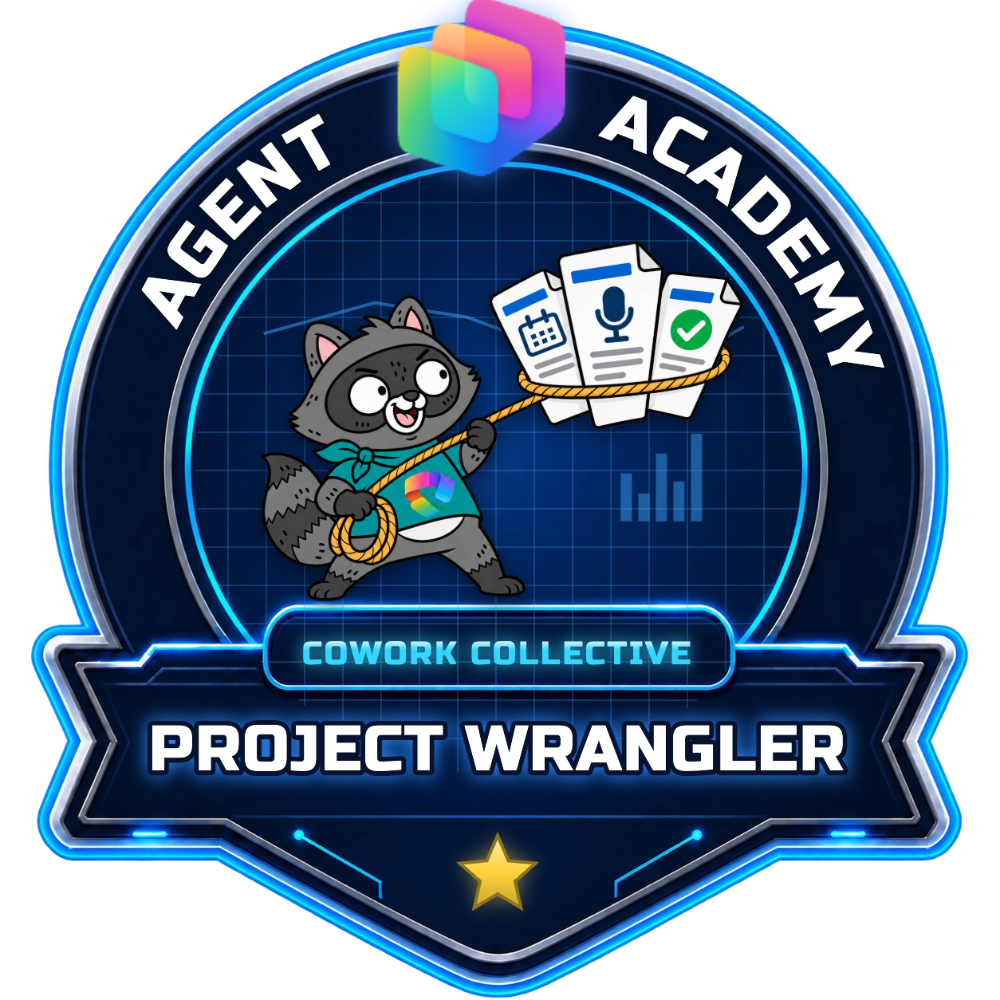</p>

**Welcome, agent.** A webinar isn't one task. You plan it, revise the documents after review, and report the results afterward. Your mission is to keep that whole lifecycle together in Cowork with Projects.

## The Problem {#the-problem}

Without projects, your planning, revisions, and reporting become separate entries in a growing **Recent chats** list. Finding the right conversation gets harder as unrelated tasks accumulate.

Projects give related tasks a named group in the sidebar, a reusable source collection, and a place to find generated files. Expand the project to see its tasks together instead of hunting through unrelated work.

You'll start three distinct tasks in one project: draft two Word documents, finalize the existing launch plan after review, and create a PowerPoint results deck with charts.

## What You'll Produce {#what-youll-produce}

By the end of this mission, you will have:

- A private project with reusable instructions and searchable source files.
- Three distinct tasks nested beneath an expandable project in the sidebar.
- A Word launch plan revised from draft to final in place, plus a separate draft speaker brief.
- A post-webinar PowerPoint with charts grounded in supplied fictional results.
- Two Word files and one PowerPoint collected under **Outputs**, not scattered across conversations.

## Prerequisites {#prerequisites}

- A work or school account with access to **Cowork** in Microsoft 365 Copilot.
- The [shared access and billing prerequisites](../index.md#access-and-billing), including an organization-permitted model and a spending policy covering Cowork.
- **Projects**, **Add to project context**, and the **Copilot** work-context category available in your account.

## How the Pieces Fit Together {#how-the-pieces-fit-together}

Think of the project as an event-planning binder. **Project context** holds the reference material, instructions describe how to work, and **Outputs** holds the documents Cowork creates.

| Piece | Purpose in this mission |
| --- | --- |
| **Project group in the sidebar** | Expands to show the related tasks together; collapses to keep navigation manageable. |
| **Project instructions** | Standing rules for subsequent interactions: formatting, draft-to-final status, source use, and action boundaries. |
| **Project context** | A curated reference collection. Add the source files here rather than attaching them separately to each task. |
| **Search project context** | Finds items in that collection so you can inspect the right source. Searching doesn't change a task's source scope. |
| **New project task** | Starts a separate assignment with the project's available context and instructions. Replying inside a task continues that task instead. |
| **Explicit task reference** | Brings selected earlier work, including a decision made during that task, into the next assignment. |
| **Recent** | Reopens the project's conversations and tasks. |
| **Outputs** | Finds available files created by the project's tasks, without opening every conversation. |

**Why use a project?** Save the source collection and working rules once, then give each task a focused assignment. This reduces repeated setup and source hunting. It doesn't guarantee shorter generation times; document creation can still take several minutes.

Here, "shared context" means context reused across **your project's tasks**. Projects are private to their creator, not shared team workspaces.

## The Scenario {#the-scenario}

You coordinate customer education at **Zava**. The Customer Success team is planning **Better Project Handoffs**, a 45-minute Microsoft Teams webinar.

Prepare a launch plan and speaker brief from a collection of planning sources. Record the decision to use an **anonymized worked example**, not a live demo.

Next, advance the fictional scenario to the internal review. Start a new task, supply the review decisions, and update the existing launch plan to **final internal planning** status. The speaker brief stays a draft.

Finally, advance to after the fictional webinar. Start a third task and produce a charted results presentation. The project keeps the planning, finalization, and reporting conversations together.

| Stage | Simulated point in the scenario | Task |
| --- | --- | --- |
| Initiation | Before the February 4, 2027 review | Create draft planning documents. |
| Review | February 4, 2027 | Apply supplied review decisions and finalize the existing launch plan. |
| Wrap-up | February 19, 2027 | Report the fictional February 18 webinar results in PowerPoint. |

These are simulated stages, not claims that a real webinar or approval has occurred. Keep the sample dates unchanged.

## Lab Assets {#lab-assets}

Download and extract the ZIP before starting. It contains the fictional planning sources, review decisions, and webinar results you'll need throughout the lab.

<download-files path="cowork-collective/launch-control/assets/sample-files" filename="launch-control-lab-assets.zip" label="Download lab assets" />

Keep the extracted folders available. You'll upload the ten files in **project-sources** when building Project context, then add files from **lifecycle-updates** at the review and wrap-up stages. Upload the individual files when instructed, not the ZIP or folders.

## Lab 1.1 - Create the Project and Working Rules {#lab-1-1}

Create one project and save its standing instructions before starting any tasks.

1. Open [Cowork](https://copilot.cloud.microsoft/cowork) with your work or school account. Find **Projects** in the sidebar and select its **New project** control.

    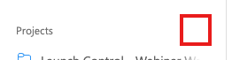

1. Enter `Launch Control - Webinar Lifecycle` as the **Project name**, choose **Blue**, and select **Create**.

    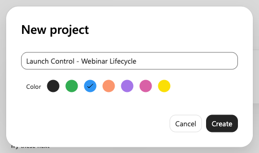

1. Select **More actions** in the project's upper-right corner, then select **Edit instructions**.

    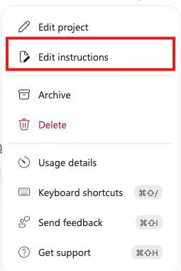

1. Copy the following text into **Project instructions**, then select **Save**.

    ```text
    You are preparing Zava's fictional Better Project Handoffs webinar and its internal follow-up.
    Use only source files added to this project's Project context and tasks I explicitly reference. Follow each request's narrower source list. Do not search my mail, calendar, chats, other files, or the web.
    Create requested deliverables as actual Word (.docx) or PowerPoint (.pptx) files, not just text replies. Use real heading styles, readable tables or charts, and brand-and-editorial.md.
    Start new deliverables with INTERNAL DRAFT - NOT SENT. Only after I explicitly confirm internal review is complete, replace that label on the named file with FINAL - INTERNAL PLANNING. Do not finalize other files or treat final planning status as business authorization.
    Separate confirmed source facts, task decisions, proposed actions, and open questions. Add Sources naming the files or referenced task actually used. Use newer supplied review or results files to update only the facts they explicitly resolve.
    Keep sample dates unchanged and label post-event results as fictional training data. Treat 60 registrations as a target and USD 500 as a ceiling, not spending approval. Do not invent names, URLs, approvals, or results.
    Do not overwrite source files. Do not send email, post in Teams, create calendar entries, collect registration data, or change business records.
    ```

    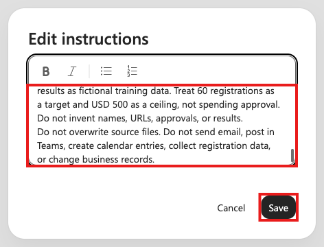

## Lab 1.2 - Build and Search Project Context {#lab-1-2}

Add a reusable reference collection before creating any tasks.

1. Select **Project context**, then **Add to project context**.

    

1. Select **Upload images and files** (the up-arrow button) in the context picker. Select all ten `.md` files from the extracted **project-sources** folder.

    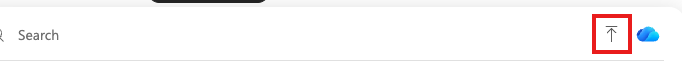

    Use the project-context picker, not **Add attachments** in the task input. Don't upload the ZIP or the containing folder.

1. Wait for the uploads to finish, then confirm **Project context** contains ten items marked **Uploaded**.

    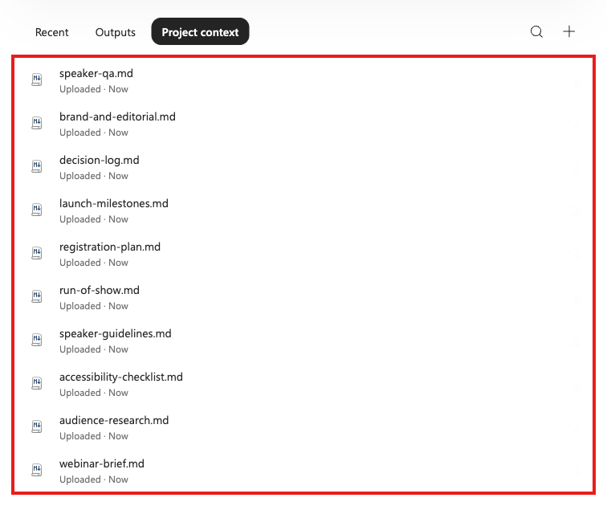

    This collection stays with the project. You won't upload it again for the later tasks.

1. Select **Search project context** and enter `speaker`. Confirm the list narrows to `speaker-guidelines.md` and `speaker-qa.md`.

    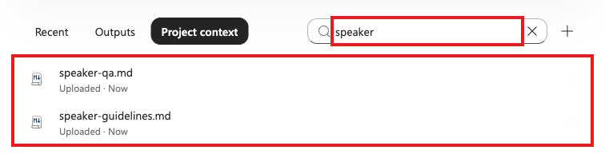

    Search helps you find a source; it doesn't restrict what the next task can use.

1. Select `speaker-guidelines.md` and read its preview. Confirm the speaker remains unconfirmed and preparation is due before the readiness review. Close the preview and clear the search.

    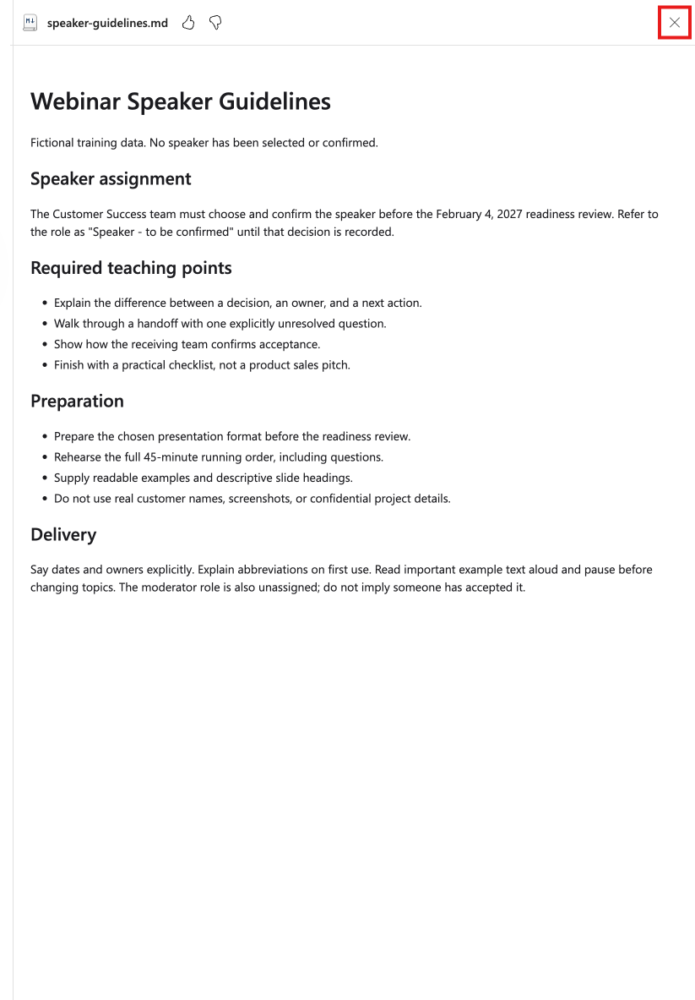

    You've found and inspected one source within a larger collection. Next, name the relevant files in your task prompt.

## Lab 1.3 - Task One: Draft the Planning Documents {#lab-1-3}

Start the first assignment from the project page. Name the source collection to use and leave later review and results files out of this stage.

1. Select **Recent** and copy the following prompt into the project input. Leave task attachments empty, then select **Send**.

    ```text
    Create exactly two Word documents using only these project sources: webinar-brief.md, audience-research.md, speaker-guidelines.md, speaker-qa.md, run-of-show.md, launch-milestones.md, accessibility-checklist.md, decision-log.md, and brand-and-editorial.md. Do not use registration-plan.md in this task.

    1. webinar-launch-plan.docx: include confirmed event facts, audience needs, the 45-minute running order, readiness milestones, and open decisions.
    2. webinar-speaker-brief.docx: include teaching points, preparation requirements, the running order, and sample audience questions. Keep speaker and moderator unconfirmed.

    For both documents, choose an anonymized worked example rather than a live demo. Label this as a planning decision made in this task, not a fact already confirmed by the sources. Keep each document to about two pages. Name the sources actually used in each document. Return links to both actual .docx files and a short summary here.
    ```

    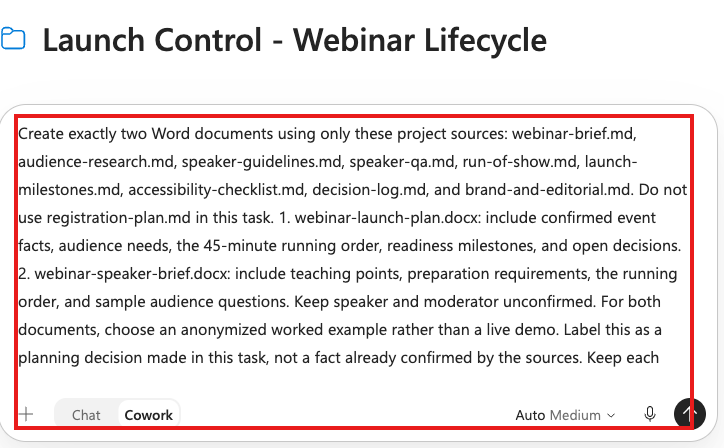

    The sources are already in **Project context**. The prompt describes what to create and narrows the source list; it doesn't repeat the saved working rules.

1. Wait for Cowork to finish creating the files. Confirm **Workspace** > **Output** contains `webinar-launch-plan.docx` and `webinar-speaker-brief.docx`.

    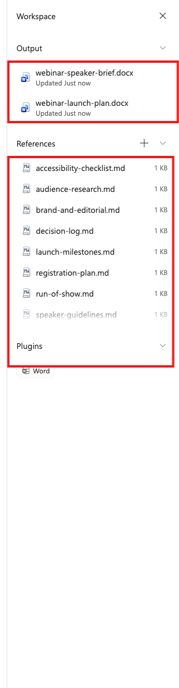

    Document creation and formatting can take several minutes. A progress message isn't the finished deliverable. If **Workspace** is closed, select **Show details panel**.

    The captured run also lists all ten project files under **References**, even though the prompt requests narrower source use. Availability and requested use are different; review the documents themselves.

1. Open **More actions for webinar-launch-plan.docx** under **Output**, then select **Open in Word**. Review the actual document, not only Cowork's summary.

    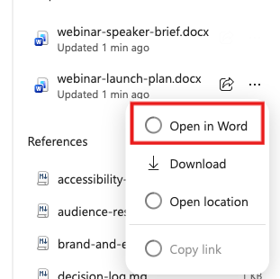

    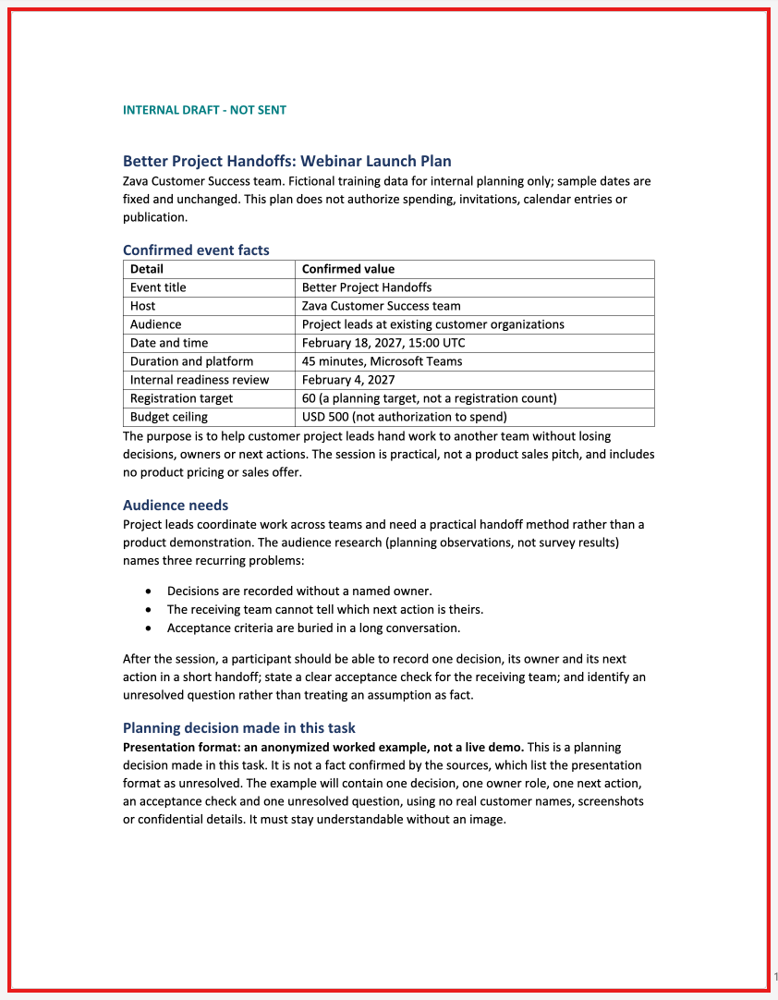

    | Check | Expected result |
    | --- | --- |
    | Reusable instructions | Starts with `INTERNAL DRAFT - NOT SENT`; uses headings, readable tables, and a **Sources** section. |
    | Confirmed facts | February 18, 2027, 15:00 UTC, 45 minutes, Microsoft Teams. |
    | Planning decision | An anonymized worked example, not a live demo; labeled as a decision made in this task. |
    | Agenda | **5 + 10 + 15 + 5 + 10 = 45 minutes**, matching `run-of-show.md`. |
    | Readiness | Milestones remain pending or planned, not complete. Speaker and moderator remain unconfirmed. |
    | Targets and limits | 60 registrations is a target; USD 500 is a ceiling, not spending approval. |

1. Return to the Cowork browser tab and open `webinar-speaker-brief.docx` through its **More actions** > **Open in Word** menu. Review the whole document, including **Sources**.

    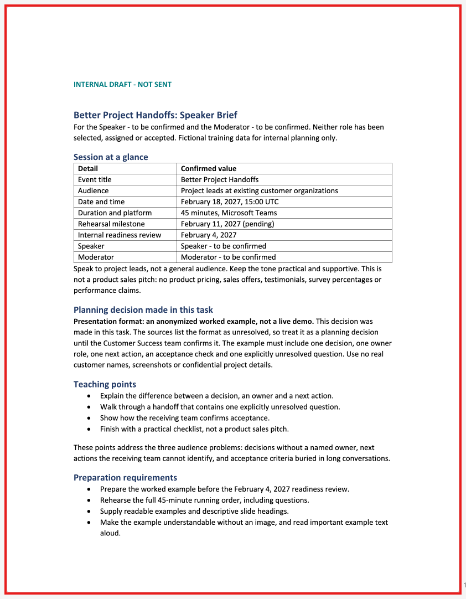

    Confirm the teaching points, preparation requirements, sample questions, draft label, and worked-example decision. Speaker, moderator, and recording decisions must not become invented commitments.

    Check that each document's **Sources** section names the files actually used and that its claims are supported by the allowed sources. Ask Cowork to correct discrepancies **in the existing document** before continuing.

1. Return to the Cowork tab, select **Launch Control - Webinar Lifecycle** under **Projects**, then select **Outputs**. Confirm both Word files appear together.

    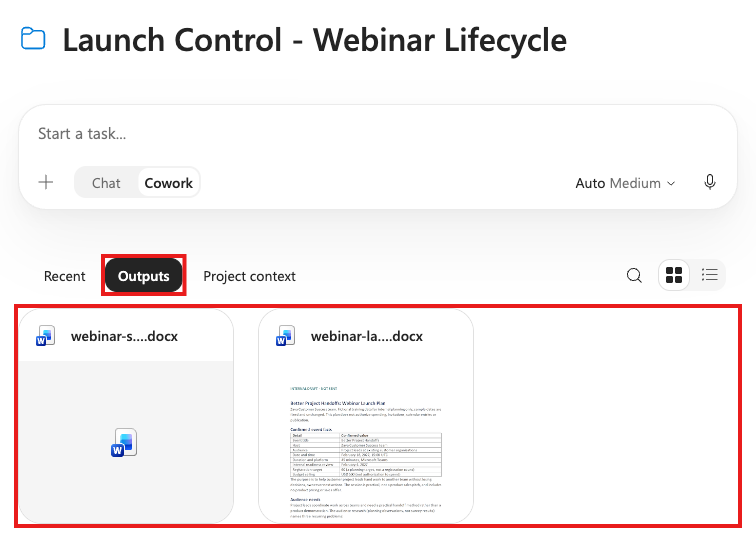

    **Project context** holds the inputs; **Outputs** holds the generated files. The files are saved in OneDrive and surfaced here, not stored only as text in a conversation.

    Note your planning task's title under **Recent**. You'll select that actual task as context for the next assignment.

## Lab 1.4 - Task Two: Revise and Finalize the Plan {#lab-1-4}

Advance the fictional scenario to the February 4 review. Keep the revision conversation separate from drafting, but update the **same launch-plan file**.

1. Open **Project context** > **Add to project context** and upload only `internal-review.md` from the extracted **lifecycle-updates** folder. Open its preview and review the decisions, then close the preview.

    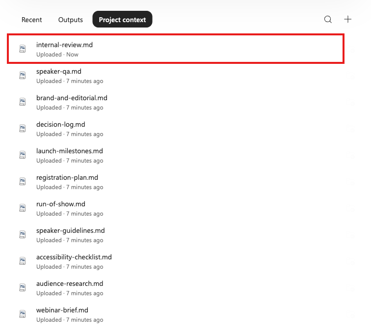

    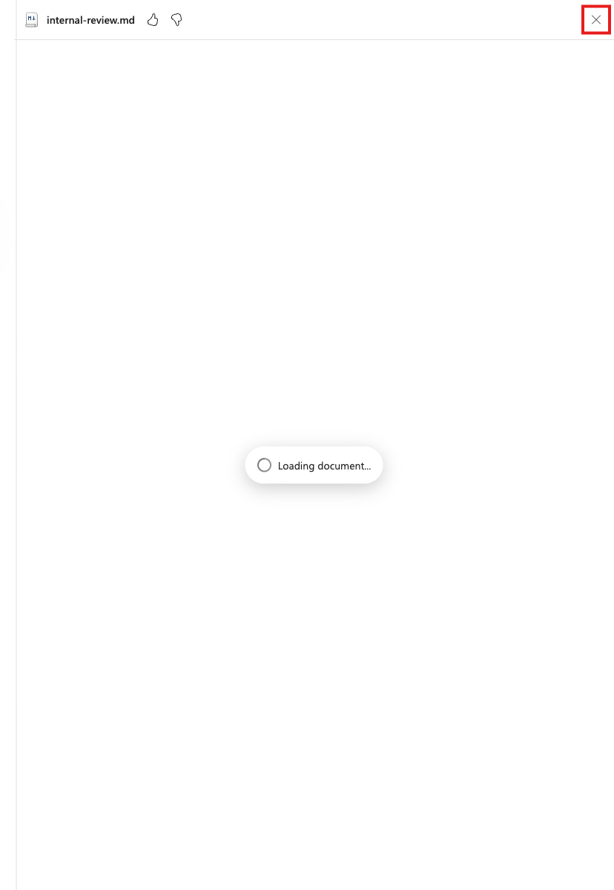

    Confirm that internal planning review is complete and the speaker, moderator, registration-owner roles, and format are resolved. Registration, accessibility, rehearsal, spending, and publication still have explicit limits.

1. Expand **Launch Control - Webinar Lifecycle** using its sidebar chevron. Confirm the drafting task is nested beneath it, then select **New task in this project** on the project row.

    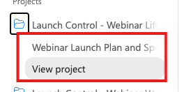

    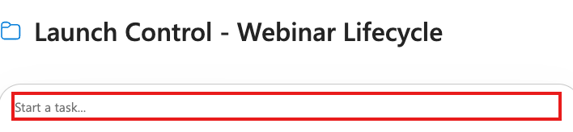

    Start from the project's empty input, with **Cowork** selected if a mode selector appears. Don't type a follow-up in the completed drafting conversation: that would continue task one.

1. Select **Add attachments** > **Add content** > **Copilot** and find your planning task. Select the actual result, place the cursor after its reference, press **Shift + Enter**, and paste this prompt. Keep the reference, then select **Send**.

    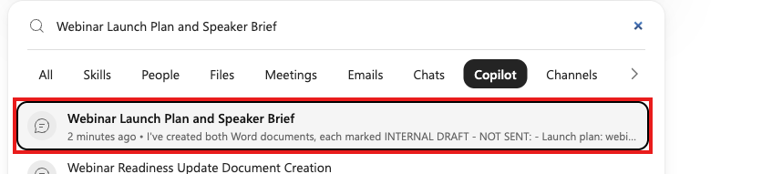

    ```text
    Use the referenced planning task, its webinar-launch-plan.docx file, internal-review.md, and brand-and-editorial.md only.
    Internal review is complete for this fictional scenario. Update the existing webinar-launch-plan.docx in place; do not create a copy or a new document. Replace INTERNAL DRAFT - NOT SENT with FINAL - INTERNAL PLANNING on this file only.
    Apply the decisions from the February 4, 2027 internal review: confirm the speaker, moderator, registration-owner roles and the anonymized worked-example format; mark the internal review complete. Replace the now-resolved open questions rather than leaving contradictory text elsewhere in the plan.
    Keep registration closed with no page or URL, the rehearsal and accessibility checks pending, and spending or external publication unauthorized. Keep the event date, time, duration, target, and ceiling unchanged. Cite internal-review.md as the newer source for the changes.
    Do not change webinar-speaker-brief.docx or any source file. Return the updated existing file link and a short change summary. Do not send or publish anything.
    ```

    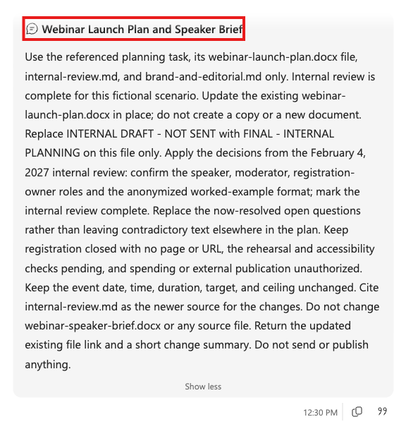

    **Copilot** finds earlier Copilot chats and tasks; **Chats** refers to Teams conversations. The selected reference has a task icon and underlined title. Typing a task title as ordinary text isn't equivalent.

    You added one new review source, not the original collection again. Project instructions still apply, including their explicit finalization exception.

1. Review the **Edit file?** request. Confirm it names `webinar-launch-plan`, not the speaker brief or a source file. Open **More options** and select **Approve once** for this requested revision.

    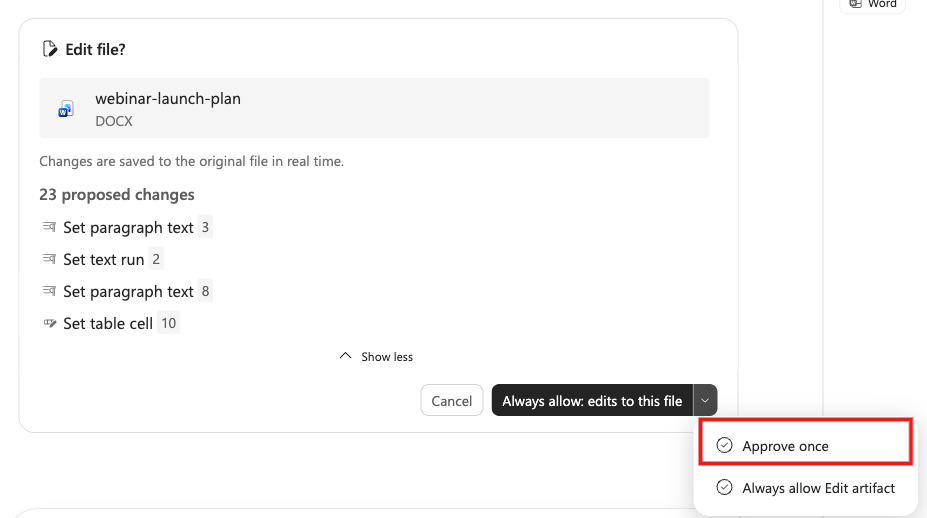

    Changes affect the original file. Cowork may request approval for another correction batch; review each request before approving it once. Cancel if the request targets a different file or exceeds this task's instructions. You don't need to enable **Always allow**.

1. Wait for the revision to finish, then open the updated launch plan in Word. Use its link in Cowork's reply, or reopen it from the project's **Outputs**. Compare it with the draft from Lab 1.3.

    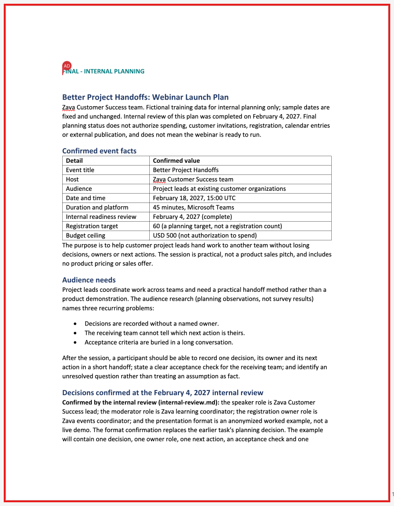

    | Check | Expected result |
    | --- | --- |
    | Same file | The existing `webinar-launch-plan.docx` is updated, not replaced with a new "final" copy. |
    | Visible status change | `FINAL - INTERNAL PLANNING` replaces `INTERNAL DRAFT - NOT SENT` on the launch plan only. |
    | Real revision | Confirmed roles and format replace the corresponding open questions; the February 4 internal review is complete. |
    | Unresolved work | Registration remains closed with no URL; rehearsal and accessibility remain pending; recording remains undecided. |
    | Traceability | **Sources** includes `internal-review.md`, while the original source files stay unchanged. |
    | Limited approval | Final internal planning status isn't permission to spend, send invitations, or publish. The speaker brief stays a draft. |

## Lab 1.5 - Task Three: Report Post-Webinar Results {#lab-1-5}

Advance to the simulated February 19 wrap-up. Add results evidence and change output type: this task creates a PowerPoint, not another Word document.

1. Open **Project context** > **Add to project context** and upload `webinar-results.csv` and `webinar-wrap-up.md` from **lifecycle-updates**. Confirm both appear in the collection.

    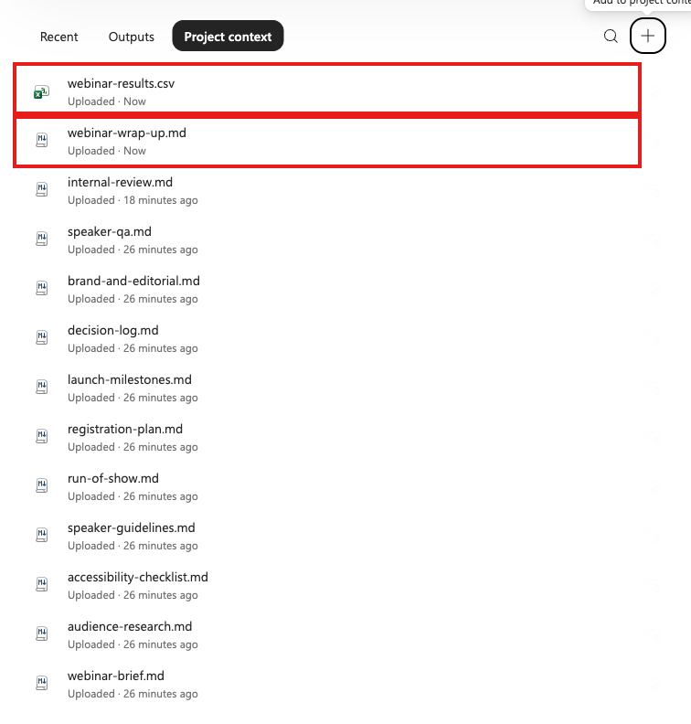

    These files supply fictional outcomes. Don't ask Cowork to infer actual attendance or satisfaction from the pre-event plan.

1. Select **New task in this project** on the project row. Confirm the input is empty and the project still groups the two earlier tasks.

    

1. Use **Add attachments** > **Add content** > **Copilot** to select the **finalization task**, not the original drafting task. Add this prompt after the selected reference, then select **Send**.

    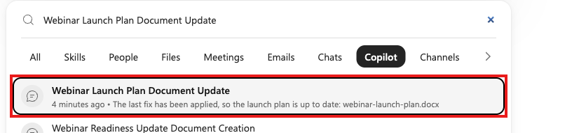

    ```text
    Create webinar-results-review.pptx, an actual six-slide PowerPoint for internal review after the fictional webinar.
    Use only webinar-results.csv, webinar-wrap-up.md, brand-and-editorial.md, and the referenced finalization task with its final launch plan. Treat this as a simulated February 19, 2027 post-event stage, not a real event report.
    Use this structure: 1) title and event summary; 2) reach chart comparing the registration target, actual registrations, and live attendees; 3) feedback-rating distribution chart; 4) what worked and question themes; 5) proposed follow-up; 6) sources and calculation methods.
    Use actual editable PowerPoint charts for slides 2 and 3. Calculate attendance rate as attendees divided by registrations, registration-target achievement as registrations divided by target, and average rating as the weighted rating sum divided by responses. Round percentages to one decimal place and the average rating to two decimal places. Show the denominators and distinguish respondents from attendees.
    Use clear navy and teal styling, readable labels, and visual layouts rather than walls of text. Label every slide Fictional training data. Do not invent revenue, spending, conversion, or impact claims. Leave the final launch plan unchanged. Return the actual .pptx file link and a short summary; do not send or publish it.
    ```

    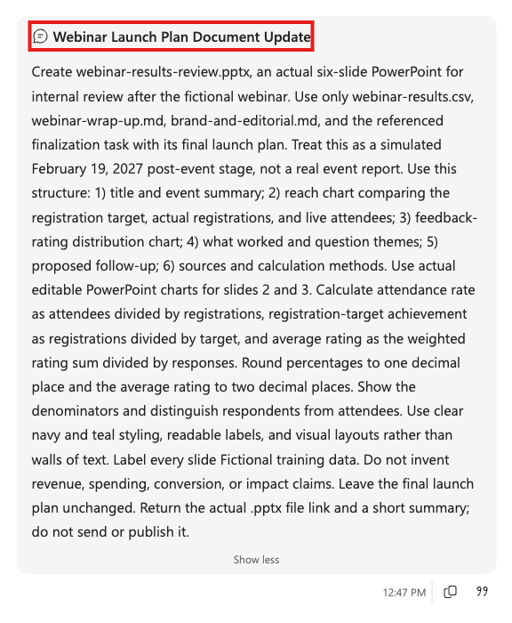

1. Wait for `webinar-results-review.pptx` to appear under **Workspace** > **Output**. Confirm Cowork created an actual presentation file, not just a slide outline in its reply.

    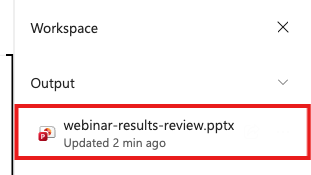

    If an inline preview is open, close it to return to **Workspace**. If the panel is hidden, select **Show details panel**.

1. Open the presentation through **More actions** > **Open in PowerPoint** and review all six slides. Check both charts against the supplied CSV.

    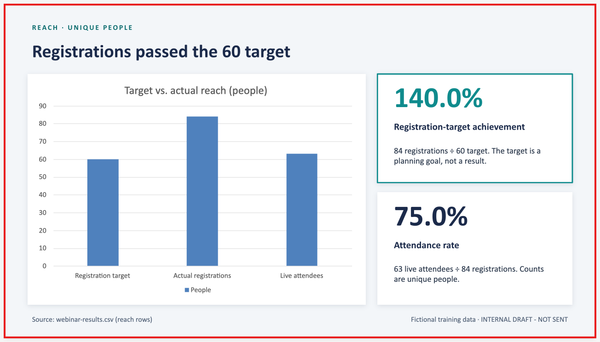

    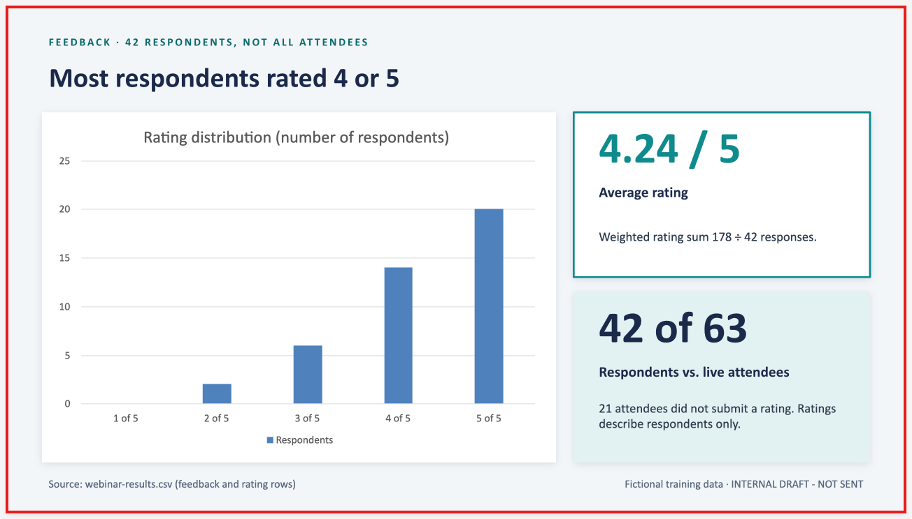

    | Check | Expected result |
    | --- | --- |
    | Reach chart | Registration target **60**, actual registrations **84**, live attendees **63**. |
    | Attendance rate | **63 / 84 = 75.0%**; registrations are the denominator, not the target. |
    | Target achievement | **84 / 60 = 140.0%**; the target and actual result remain distinct. |
    | Feedback chart | Ratings 1 through 5 have counts **0, 2, 6, 14, 20**, totaling **42 respondents**. |
    | Average rating | **178 / 42 = 4.24 out of 5**; don't treat all 63 attendees as respondents. |
    | Evidence and status | Every slide identifies fictional training data; proposed follow-up isn't presented as approved or completed. The new deck retains its draft status. |
    | Earlier work preserved | The final launch plan stays the February 4 planning snapshot, not an overwritten post-event report. |

## Lab 1.6 - See the Whole Project Together {#lab-1-6}

1. Return to the project and select **Recent**. Use each task's **More actions** > **Rename** to give the three completed assignments clear names: `Draft planning files`, `Finalize launch plan`, and `Review webinar results`. Select **Save** for each name.

    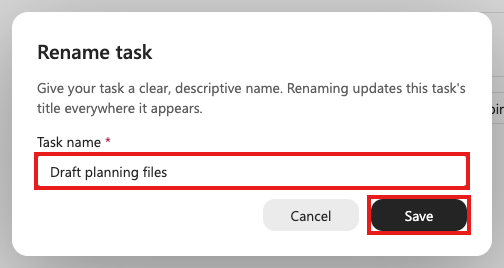

    Renaming changes the task titles, not the documents or their filenames.

1. Return to the project. Collapse and expand its sidebar chevron, then confirm **three different tasks** are nested beneath **Launch Control - Webinar Lifecycle**.

    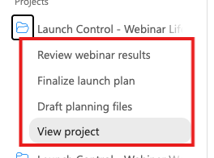

    Open each task from this group to return to its own conversation. You don't need to search a crowded **Recent** list for planning, revisions, and results.

1. Select **Outputs** > **List view**. Confirm the two Word files and PowerPoint appear together. Use **Search outputs** to find `speaker`, then clear the search.

    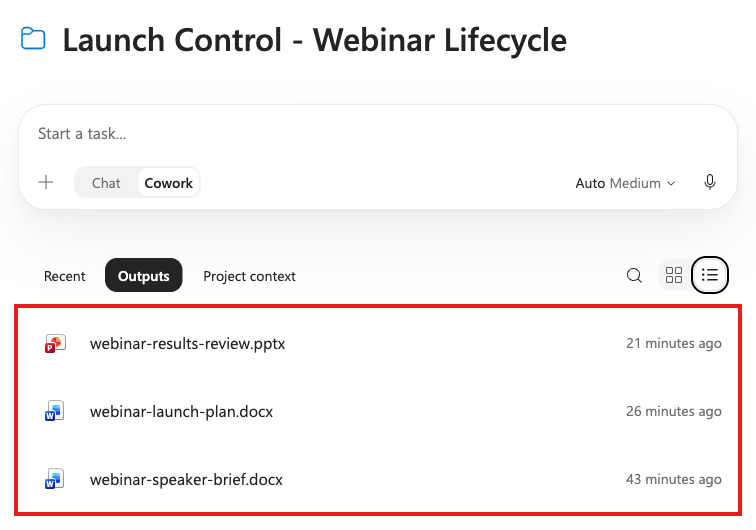

    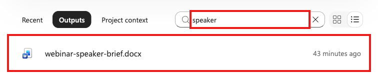

    Three tasks don't require three copies of the launch plan. The finalization task updated the existing file; the speaker brief and results deck are separate deliverables.

    Use the expanded sidebar or **Recent** for conversations, **Project context** for reference material, and **Outputs** for files.

## Mission Accomplished {#mission-accomplished}

You've built a reusable workspace, not just a collection of replies:

- **Grouped work:** Three distinct tasks are nested under one expandable project instead of scattered among unrelated recent work.
- **Reusable context:** Ten initial sources and three staged updates support planning, review, and post-event reporting.
- **Controlled revision:** An explicit reviewed update changes one existing Word file from draft to final without finalizing everything.
- **Varied deliverables:** Two Word documents and a charted PowerPoint appear together under **Outputs**.
- **Grounded reporting:** You distinguish targets from fictional results and verify chart values, denominators, and unresolved decisions.

## Claim Your Project Wrangler Badge {#claim-your-badge}

<!-- markdownlint-disable-next-line MD033 -->
<p align="center"></p>

Congrats, agent — mission accomplished! To request your **Project Wrangler** badge, complete the lab, then submit the badge request form:

[Claim your Project Wrangler badge](https://aka.ms/cowork-collective/project-wrangler/form)

Answer the knowledge-check questions based on the work you completed. Once reviewed, you'll receive an email from Global AI Community with instructions to claim your badge.

## Related Content {#related-content}

- [Organize work with Projects](https://learn.microsoft.com/en-us/copilot/cowork/cowork-projects?WT.mc_id=power-172621-ebenitez)
- [Reference previous chats and tasks](https://learn.microsoft.com/en-us/copilot/cowork/use-cowork?WT.mc_id=power-172621-ebenitez#reference-previous-chats-and-tasks)
- [What's new in Copilot Cowork](https://learn.microsoft.com/en-us/copilot/cowork/whats-new?WT.mc_id=power-172621-ebenitez)

<analytics-tag section="cowork-collective" mission="launch-control" />
