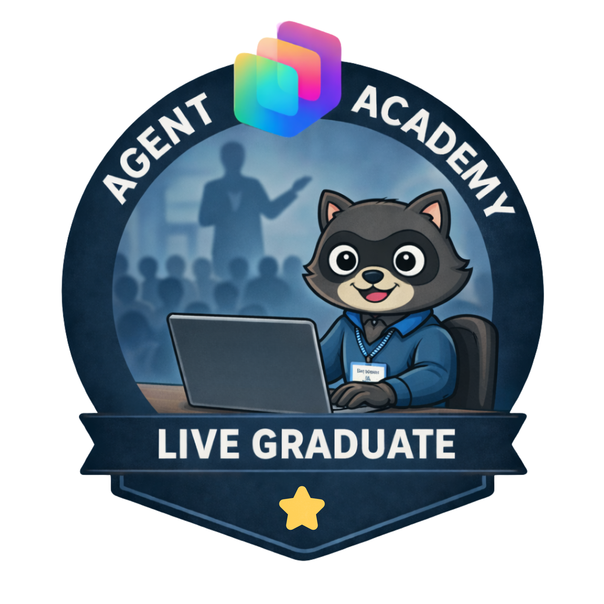
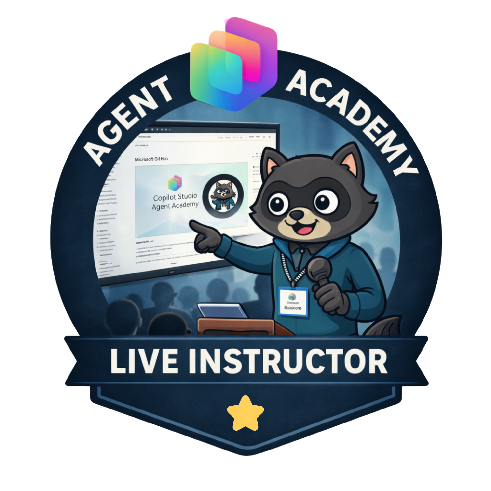

# Workshops

Bring Agent Academy to your team or your stage.

Agent Academy isn't just a self-paced curriculum, it's designed to be delivered live. Whether you're an MVP or community speaker running a conference workshop, or an organization looking to upskill your team, everything you need is here.

[Find a workshop](#workshop-schedule) · [Get facilitator resources](#facilitator-resources) · [Request workshop badges](#how-to-get-badges-for-your-event)

## Facilitator resources

Planning a workshop? Start with a speaker deck and the facilitator guide. Choose the deck that matches the course your participants will follow.

<!-- markdownlint-disable MD033 -->
<WorkshopsPage>
  <template #recruit>
    <download-files path="events/workshops/assets/Recruit-NextGen-Workshop.pptx" label="Download NextGen Recruit deck" />
  </template>
  <template #operative>
    <download-files path="events/workshops/assets/Operative-NextGen-Workshop.pptx" label="Download NextGen Operative deck" />
  </template>
</WorkshopsPage>
<!-- markdownlint-enable MD033 -->

## Bring Agent Academy to your audience

::: info 🎤 For speakers & MVPs
Take the Agent Academy curriculum to your next conference session or community event. The material is structured, hands-on, and built to be delivered.
:::

::: info 🏢 For organizations
Run Agent Academy as an internal workshop for your team. Get your developers, makers, and IT pros building real agents together with a facilitator guiding the way.
:::

::: info 🤝 Better together
Live delivery changes the learning dynamic. Questions get answered in real time, peers learn from each other, and teams leave with shared context and working agents.
:::

## Workshop schedule

Agent Academy workshops happening around the world, delivered by MVPs and community speakers. Want to add yours? [Get in touch.](mailto:poweradvocates@microsoft.com?subject=Agent%20Academy%20Workshop%20Listing%20Request)

Browse upcoming workshops or look back at past events. Workshops move to Past automatically after their scheduled date.

<!-- markdownlint-disable MD033 -->
<ClientOnly>
  <WorkshopSchedule />
  <template #fallback>
    
Enable JavaScript to browse upcoming and past workshops.

  </template>
</ClientOnly>
<!-- markdownlint-enable MD033 -->

## 🏅 Free badges for your participants

When you deliver an official Agent Academy workshop, we provide free digital badges for everyone in the room, both participants and facilitators, issued through the [Global AI Community](https://globalai.community).

| | Badge | Who earns it |
|---|---|---|
| {width=100} | **Live Graduate** | Every participant who completes the workshop |
| {width=100} | **Live Instructor** | Facilitators who deliver an official Agent Academy workshop |

### How to get badges for your event

1. **Email us** at [poweradvocates@microsoft.com](mailto:poweradvocates@microsoft.com?subject=Agent%20Academy%20Workshop%20Badge%20Request) to let us know you're delivering an Agent Academy workshop
1. **We'll send you forms** to collect participant and facilitator details
1. **Badges are issued** through the [Global AI Community](https://globalai.community) platform so participants will need to create a free account to receive theirs

::: tip
Let us know about your workshop as early as possible so we can get the forms to you in time to distribute to participants on the day.
:::
