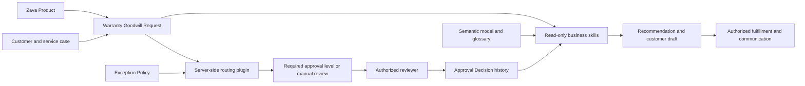

# Mission 01: Understand Business Applications in Work IQ {#mission-01-business-applications-work-iq}

<mission-meta />

## Mission Brief

A commercial coffee machine fails during morning service. A subscription arrives late. A loyal customer asks for help shortly after a warranty expires. Each situation needs context, a policy, and someone authorized to decide.

Zava currently coordinates these exceptions through email, Teams, and spreadsheets. Service agents cannot reliably explain who must approve a request, managers repeatedly ask for missing information, and finance cannot see the whole recovery process.

Your assignment is **Operation Recovery Intelligence**: give people and agents a shared, governed picture of the situation. You are not building an agent that grants refunds. You are building the evidence and controls that make responsible decisions easier.

## Objectives

In this mission, you'll learn:

1. How Zava's customer recovery process connects cases, requests, policies, and decisions.
1. Why routing rules belong in Dataverse rather than an agent's judgment.
1. How semantic models and business skills provide different kinds of context.
1. Where approval and fulfillment remain human responsibilities.

## From Records to Intelligence

Think of the solution as an investigation desk. **Dataverse records** are the evidence files. A **routing plugin** is the rulebook that sends a case to the correct authority. A **semantic model** is the desk's shared vocabulary. **Business skills** are the procedures an analyst follows when preparing a brief.

Business Applications in Work IQ connects that application context to supported agents and Microsoft 365 experiences. An agent can retrieve the request, explain its approval path, and identify an unresolved reviewer question without asking someone to open five forms.

The distinction matters: a relationship connects records, but does not enforce a business rule. A skill describes a process, but does not grant permission. A confident explanation is not an approval.

| Layer | Zava responsibility | What it must not do |
| --- | --- | --- |
| Tables and relationships | Preserve request facts and decision history | Invent missing information |
| Security roles | Control table operations and access depth | Pretend a table privilege enforces a status or column restriction |
| Server-side plugin | Match a submitted request to an active policy | Approve compensation |
| Semantic model | Explain terms, views, and relationships | Replace Dataverse access controls |
| Business skills | Summarize evidence, assess readiness, recommend next steps | Override policy or change records in this course |
| Authorized staff | Review, approve, fulfill, and communicate | Treat an agent-generated draft as a completed transaction |

## The Zava Process

A service case captures the original issue. A Warranty Goodwill Request links it to the customer, product, requested recovery, estimated amount, and business justification.

When a request is submitted, the plugin matches its facts against active Exception Policies. A clear match records the policy and required approval level. Missing or ambiguous information leads to **Needs Manual Review**, not a guessed route.

An Approval Decision is a separate record. A request can have several decisions: an information request followed by a later approval, for example. That history must remain visible. Finally, staff review fulfillment and draft a customer response grounded in what actually happened.



## Lab 1: Establish the Decision Boundaries

### Lab 1.1: Classify recovery scenarios

1. Read each scenario and identify the next responsible action.
1. Compare your reasoning with the expected boundary.

| Situation | Expected boundary |
| --- | --- |
| A $1,299 replacement needs Executive approval; its decision is Pending | Explain that review is outstanding; do not promise a replacement |
| A Draft has Unknown warranty and no customer impact | Identify missing information before submission; do not select a policy |
| A reviewer asks for prior-credit history | Gather the requested evidence; a completed form alone is not ready |
| A later Finance decision approves a $749 replacement | Recognize the later approval; do not claim the replacement shipped |
| Credit-issued notes conflict with the request's current status | Flag the inconsistency and seek clarification; do not issue another credit |

### Lab 1.2: Review your solution contract

1. Open your private lab notes from Mission 00.
1. Record the solution name `ZavaWarrantyGoodwillApproval` and customization prefix `zava`.
1. Record these invariants:

    ```text
    The tables hold the facts.
    The plugin determines the approval path.
    The skills explain evidence and recommend next actions.
    Authorized people make approval, fulfillment, and sending decisions.
    Missing information is not recorded, not a license to guess.
    ```

1. Confirm you will use fictional sample data in the development environment, not customer production records.

## Mission Complete

You can now explain **the business problem**, **the responsibility of each layer**, and **the boundary between recommendations and authorized action**.

Next: [Mission 02: Build the Zava Data Foundation](../02-data-foundation/).

## Tactical Resources

- [Business Applications in Work IQ quickstart](https://learn.microsoft.com/power-platform/admin/business-applications-work-iq/quickstart)
- [Business skills overview](https://learn.microsoft.com/power-apps/maker/data-platform/data-platform-business-skill-overview)
- [Semantic model overview](https://learn.microsoft.com/power-apps/maker/data-platform/semantic-model-overview)

<analytics-tag section="intelligence-officer" mission="01-business-applications-work-iq" />
