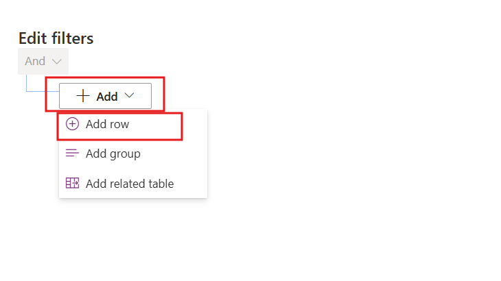
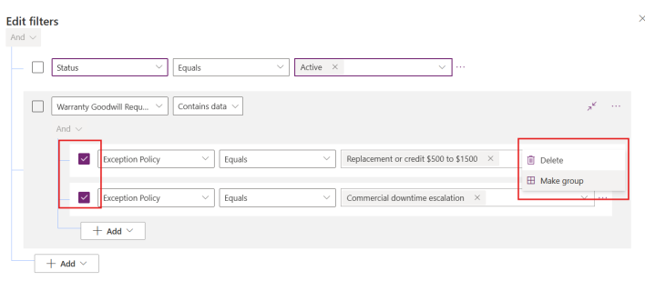
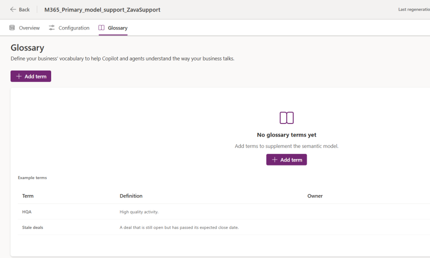

# Mission 07: Enrich Business Meaning {#mission-07-semantic-model}

<mission-meta />

## Mission Brief

"Which products need attention?" sounds simple until different people interpret attention as pending approval, high cost, or commercial downtime.

In **Operation Shared Language**, you'll define Zava's meaning in a saved view and add glossary terms for its shorthand. A semantic model makes those definitions available as context for supported agent experiences.

The model is a shared field dictionary, not a replacement database. It helps an agent choose the intended query, while Dataverse still stores the records and enforces access.

## Objectives

In this mission, you'll learn:

1. How model items, glossary terms, and data scope contribute different context.
1. How a saved view makes a business filter explicit.
1. When model regeneration is required.
1. How to compare natural-language results with a known record baseline.

## A View Defines the Filter

Zava's definition of **Product Needs Attention** is: active products with at least one related recovery request assigned to **POL-2002** or **POL-2004**.

That is a filter on recorded policy assignments, not an instruction to independently apply policy thresholds. The expected baseline products are **PROD-1001, Zava Pro X1 Espresso Machine**, and **PROD-1002, Zava Office Brewer 500**.

A saved view applies deterministic filter logic. An agent's interpretation of natural language is not guaranteed deterministic; verify the actual returned records and the intended view rather than promise identical answers.

| Model building block | What it contributes |
| --- | --- |
| Model items | Context extracted from relationships, views, forms, descriptions, and other available metadata |
| Glossary | Maker-authored business terminology linked to specific fields and values |
| Data | The Dataverse tables included in the model's scope |

> [!NOTE]
> If the experience offers sample-data use during model generation, review the data scope and your organization's approval before enabling it. A semantic model does not grant access to records a user could not otherwise read.

## Lab 7: Define Products That Need Attention

### Lab 7.1: Inspect the initial model

1. Open [Power Apps preview](https://make.preview.powerapps.com) and select your development environment.
1. Select **More** > **Discover all** > **AI** > **Semantic Model (preview)**.
1. Open the model associated with **Zava Support**.
1. Review **Overview**, including model items, glossary, and data scope.
1. Open **Configuration** > **Zava Product** > **Views**.
1. Note which views are listed before your changes.
1. Select **View tables** to open the table configuration.

### Lab 7.2: Create Product Needs Attention

1. Open **Views** under the Zava Product table's **Data experiences**.
1. Select **New view**.
1. Enter `Product Needs Attention` as the name.
1. Enter this description:

    ```text
    Active products with at least one warranty or goodwill request assigned
    to Replacement or credit $500 to $1500 or Commercial downtime escalation.
    Use this view to find products that need a service lead's attention.
    ```

1. Select **Create**.
1. Select **Edit filters**.
1. Select **Add** > **Add row**.

    

1. Set **Status** > **Equals** > **Active**.
1. Select **Add** > **Add related table**.
1. Choose **Warranty Goodwill Request (Zava Product)** and **Contains data**.
1. Add **Exception Policy** > **Equals** > **Replacement or credit $500 to $1500**.
1. Add a second row: **Exception Policy** > **Equals** > **Commercial downtime escalation**.
1. Select the two policy rows and select **Make group**.
1. Change that group's condition to **Or**.

    

1. Keep the top-level condition **And** so the product must also be Active.
1. Select **OK** and inspect the filter again.
1. Preview the results and verify the two expected product codes.
1. Select **Save and publish**.

> [!IMPORTANT]
> Two policies inside an **And** group cannot match a single request's one policy lookup. Keep the two policy choices in an **Or** group. The screenshot shows grouping in progress; verify the final group really says **Or**.

### Lab 7.3: Regenerate and inspect the summary

1. Return to the semantic-model page and refresh it.
1. Select **Regenerate**.
1. Wait until the regeneration status completes and **Last Regeneration Timestamp** updates.
1. Open **Configuration** > **Zava Product** > **Views**.
1. Open **Product Needs Attention** and inspect its generated summary.
1. Verify it describes the Active product filter and the two policy alternatives.
1. Exclude a view only if you have established that its definition is obsolete for this model.
1. Select **Save** if you changed the model's selected items.

Metadata changes outside the semantic-model page require regeneration. Only changes present when the job starts are included. Model-page selections use **Save**; do not assume a queued job or an old timestamp means your new view is available.

## Lab 8: Add and Test Zava Vocabulary

### Lab 8.1: Add glossary terms

1. Open the model's **Glossary** tab.
1. Select **Add item** or **Add term**, depending on the preview UI.

    

1. Add each term and definition:

| Term | Definition |
| --- | --- |
| OOW | Out of warranty. Refers to Expired in Warranty Status on Warranty Goodwill Request. |
| IW | In warranty. Refers to In Warranty in Warranty Status on Warranty Goodwill Request. |
| GW | Goodwill. Refers to Goodwill Credit in Request Type on Warranty Goodwill Request. |

1. Confirm each entry appears in the glossary.

The workshop experience applies glossary entries without a separate regeneration. If your UI displays a save action or processing state, complete it and verify availability rather than assume immediate propagation.

### Lab 8.2: Test against the baseline

1. Open [Microsoft 365 Copilot](https://m365.cloud.microsoft) with the same approved account.
1. Start a new chat.
1. Enter:

    ```text
    In my Zava Support development environment, show products that need
    attention using the Product Needs Attention view. Return product code
    and name. Do not change records.
    ```

1. Compare the result with the saved view: **PROD-1001** and **PROD-1002**.
1. Enter:

    ```text
    In the same environment, among baseline requests REQ-3001, REQ-3002,
    REQ-3003, REQ-3004, REQ-3005, and REQ-3006 only, show OOW goodwill
    requests. Return Request Code, Request Type, and Warranty Status.
    Do not include course-test records or change any data.
    ```

1. Confirm **REQ-3002**, **Goodwill Credit**, **Expired**.
1. Repeat with `IW goodwill requests` and the same baseline restriction.
1. Confirm there are **no matching baseline records**.

> [!NOTE]
> The workshop PDF's claim of seven IW goodwill records does not match the supplied CSVs. The correct baseline result is zero. Mission 05 also creates extra course-test records, so unrestricted table counts need not equal the seeded baseline.

### Lab 8.3: Diagnose a mismatch

1. Compare mismatched results with a read-only query over the same table, environment, and baseline codes.
1. Confirm the intended model, view, glossary, regeneration timestamp, and app participation.
1. Start a new chat after model changes and inspect available query or source details.
1. Record the mismatch if it persists; do not change business records to fit an expected screenshot.

## Mission Complete

You have defined **an explicit business filter**, added **Zava vocabulary**, and checked **agent results against source records**.

Next: [Mission 08: Manage Skills in Power Apps](../08-skill-builder/).

## Tactical Resources

- [Semantic model overview](https://learn.microsoft.com/power-apps/maker/data-platform/semantic-model-overview)
- [Create and edit public views](https://learn.microsoft.com/power-apps/maker/model-driven-apps/create-edit-views)
- [Use Business Applications in Work IQ](https://learn.microsoft.com/power-apps/user/use-business-apps-work-iq)

<analytics-tag section="intelligence-officer" mission="07-semantic-model" />
