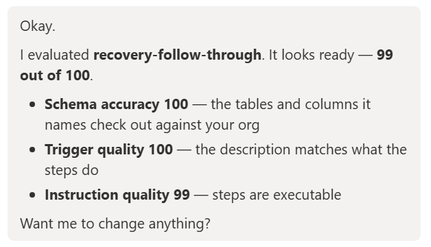
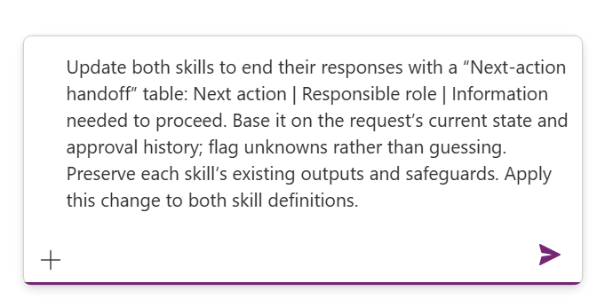
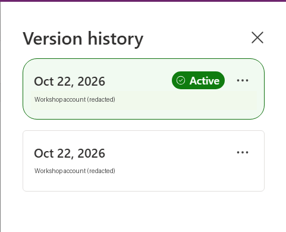

# Mission 08: Manage Skills in Power Apps {#mission-08-skill-builder}

<mission-meta />

## Mission Brief

Zava's service lead needs more than a request summary. They need a next step and a customer update that does not promise an unapproved credit or an unconfirmed shipment.

In **Operation Follow Through**, you'll turn the supplied recovery procedure into **Zava Recovery Follow-through Planner**. You'll inspect its instructions, evaluate it, and update two skills together to produce a consistent next-action handoff.

The procedure is a field manual: define it once, then apply it to each request's evidence. The agent prepares the recommendation and draft; authorized staff retain approval, fulfillment, and sending responsibilities.

## Objectives

In this mission, you'll learn:

1. How to ground a business skill in a documented procedure.
1. How to distinguish skill-definition quality from runtime correctness.
1. How activation and sharing affect discoverability without replacing data permissions.
1. How to evolve multiple skills and inspect prior versions.

## Preview Experience Checkpoint

The workshop uses **Skill Builder**, **Save and activate**, multi-skill editing, evaluation scores, and version history. Public documentation may instead show a manual editor with **Save**, resource attachments, and skills active by default.

| Your experience | What to do |
| --- | --- |
| Workshop Skill Builder controls are present | Complete the main labs below |
| Only the documented manual editor is available | Use the manual alternative to create the planner and handoff format; record evaluation, multi-skill editing, and history as unavailable |
| Business skills itself is unavailable | Stop and verify Work IQ features, permissions, and preview eligibility with your administrator |

> [!IMPORTANT]
> The manual alternative reaches the skill-content objective, but it does not demonstrate the missing preview controls. Do not claim those UI exercises are complete. Screenshots below are extracted workshop examples, not evidence of a run in your environment.

## What the Procedure Protects

The supplied procedure distinguishes historical blockers from current ones, requested from approved amounts, and approval from fulfillment. It also requires clarification for ambiguous request codes, missing or tied decision dates, and conflicting records.

A customer-response draft must exclude internal deliberations and unnecessary personal information. It must not invent dates, amounts, approvals, or guarantees.

Sharing a skill makes its **instructions** available. It does not grant the recipient permission to read every underlying request. Role-based skill access can require both the named role and **Skill Sharing Role**; review the current documentation before assigning anything.

## Lab 8: Build the Recovery Planner

### Lab 8.1: Create the follow-through planner {#lab-81-create-the-follow-through-planner}

<download-files path="intelligence-officer/08-skill-builder/assets/zava-recovery-follow-through-procedure.md" filename="zava-recovery-follow-through-procedure.md" />

1. Download and read the full recovery follow-through procedure.
1. Open [Power Apps preview](https://make.preview.powerapps.com).
1. Confirm your development environment.
1. Select **More** > **Business skills (preview)**.
1. Confirm the two skills from Mission 06 are listed.
1. Select **Start from scratch** to open Skill Builder.
1. Enter:

    ```text
    Create a skill named Zava Recovery Follow-through Planner,
    unique name zava_recoveryfollowthroughplanner, for our recovery
    follow-through procedure using the attached guidance.

    Input is one exact Zava Request Code. Ground it in the actual
    Warranty Goodwill Request, customer Account, custom support_incident
    Case, Zava Product, Exception Policy, and all Approval Decisions.
    Read only. Use recorded dates for decision chronology.
    Follow the attached procedure's clarification and conflict rules.

    Output current position, supporting records, next recommended action,
    unresolved information or conditions, and a short customer-response
    draft. Do not approve, update, fulfill, or send anything.
    ```

1. Select the attachment **+** and choose `zava-recovery-follow-through-procedure.md`.
1. Select **Send**.
1. Review the generated definition and its exact schema references.
1. Verify the name and unique name; correct a generated name before saving if necessary.

The file is supplied locally with this course. You do not need to create a SharePoint site or assume an existing workshop document library.

### Lab 8.2: Evaluate and activate

1. Inspect the generated instructions using the instruction preview control.
1. Check that they retain every safeguard in the procedure, including missing/tied dates, unresolved conditions, and approval-versus-fulfillment distinctions.
1. Enter `Evaluate the skill's schema accuracy, trigger quality, and instruction quality. Explain any gaps and propose corrections.`
1. Review the evaluation findings.

    

1. Correct justified definition gaps and evaluate again.
1. Select **Save and activate** after review.
1. Add the skill to **Zava Warranty & Goodwill Approval** using **Solutions** > **Add existing** > **Business skill**.

A high quality score is not proof that the skill will interpret REQ-3006 correctly. Runtime checks against live evidence follow in Mission 09.

### Lab 8.3: Review sharing deliberately

1. Select **Share** for the planner.
1. Inspect **General access**, **Security roles**, and **Direct access**.
1. Keep the skill private for your own course testing unless another approved test user needs access.
1. If sharing is required, choose the minimum approved view access for that user or role.
1. Review the recipients and permission level before selecting **Share**.

> [!WARNING]
> **Anyone can view** exposes the skill definition broadly within the environment. It is not necessary for a single-user lab and does not grant access to business records. Do not assign roles or enable broad sharing merely to make a missing preview UI appear.

## Lab 9: Evolve the Skills Together

### Lab 9.1: Add the next-action handoff

1. Keep the planner open in Skill Builder.
1. Select **+** in the top command bar to open another skill.
1. Select **Zava Approval Readiness Advisor**, then **Open**.
1. Confirm the two intended skill tabs are open.
1. Enter:

    ```text
    Update both open skills to end their responses with a
    "Next-action handoff" table:
    Next action | Responsible role | Information needed to proceed.

    Base each handoff on the request's current state and approval history.
    Flag unknowns rather than guessing. Preserve each skill's existing
    response sections, readiness rules, read-only scope, and safeguards.
    Do not modify Zava Customer Recovery Summary or any business record.
    ```

    

1. Inspect each skill's instructions separately to confirm both changed.
1. Select **Save and Activate All**.
1. Verify both saved definitions include the handoff and preserve their earlier boundaries.
1. Rerun the Advisor test for **REQ-3002** and confirm its Not ready verdict is unchanged.

### Lab 9.2: Inspect version history

1. Select the planner's tab.
1. Open **Version history**.
1. Identify the currently active version and the earlier saved version.

    

1. Open the earlier version's **...** menu and select **View version**.
1. Compare its output instructions with the active version.
1. Select **Exit** to leave the historical view without restoring it.

Your version count and timestamps can differ from the workshop. Verify the actual history rather than expect a specific number of rows.

## Manual Editor Alternative

Use this section only if the supported manual editor is present but the newer Skill Builder controls are absent.

1. Open **Business skills (preview)** and select **New business skill**.
1. Enter **Zava Recovery Follow-through Planner** and verify its unique name uses the Zava prefix.
1. Enter a description identifying when to use the skill: a service lead asks for next actions and a customer draft for one recovery request.
1. Paste the procedure into **Instructions**, preceded by the input, data scope, output, and read-only contract from Lab 8.1.
1. Append the **Next-action handoff** table requirement from Lab 9.1.
1. Select **Save** and inspect the skill's activation state; the documented editor can create skills active by default.
1. Attach the original markdown under **Resources** if the editor supports it.
1. Add the planner to the course solution.
1. Edit **Zava Approval Readiness Advisor** separately to append the same handoff requirement.
1. Save and verify both definitions.

The procedure is in the instructions as well as the optional resource so execution does not depend on an agent silently ignoring an attachment. This alternative does not reproduce Skill Builder evaluation, multi-skill authoring, or version-history inspection.

## Mission Complete

You have created **a procedure-grounded planner**, reviewed **activation and sharing**, and added **a consistent next-action handoff**. Record which preview controls you could exercise and any unavailable UI objectives.

Next: [Mission 09: Apply Recovery Skills in Cowork](../09-cowork-recovery/).

## Tactical Resources

- [Create, manage, and share business skills](https://learn.microsoft.com/power-apps/maker/data-platform/data-platform-business-skills)
- [Business skill security and governance](https://learn.microsoft.com/power-apps/maker/data-platform/data-platform-business-skill-overview#security-and-governance)
- [Work IQ MCP overview](https://learn.microsoft.com/microsoft-365/copilot/extensibility/work-iq/mcp/overview)

<analytics-tag section="intelligence-officer" mission="08-skill-builder" />
