---
prev:
  text: "Schedule Interviews with Work IQ"
  link: "/operative-nextgen/10-work-iq-scheduling"
next:
   text: "Securing Your Operative Badge"
   link: "/operative-nextgen/course-completion-badges-operative"
hide: false
preview: true
short-description: Run your evaluation sets, publish to Microsoft 365 Copilot and Teams, share the agent, then watch real sessions in Monitor
difficulty: 3
codename: OPERATION HOMECOMING
time: 50
tags:
  - evaluation
  - compliance
products: [copilot-studio, dataverse, teams, microsoft-365-copilot]
industries:
  - hr
created-date: 2026-01-14
last-edited-date: 2026-10-29
---

# 🚨 Mission 11: Evaluate, Publish, and Monitor Your Agent {#mission-11-evaluate-publish-and-monitor-your-agent}

<mission-meta />

## 🎯 Mission Brief {#mission-brief}

Welcome back, Operative. In this mission you'll run the evaluation sets you've been accumulating since Mission 02, stamp a version into the agent's greeting, publish it to **Microsoft 365 Copilot** and **Teams**, share it with the right people, test the whole system the way a recruiter will actually use it, and then open **Monitor** to read back the sessions those real users produced.

## 🔎 Objectives {#objectives}

In this mission, you'll learn:

1. How to verify the **Maker** connection used by a Dataverse evaluation case
1. How to version an agent and verify which release a **published channel** is serving
1. How to publish an agent to **Microsoft 365 Copilot** and **Teams**, and share it
1. How **Evaluate** before release and **Monitor** after it answer different questions
1. How user **reactions** feed back into the test sets you keep re-running

## 🏗️ What you built {#what-you-built}

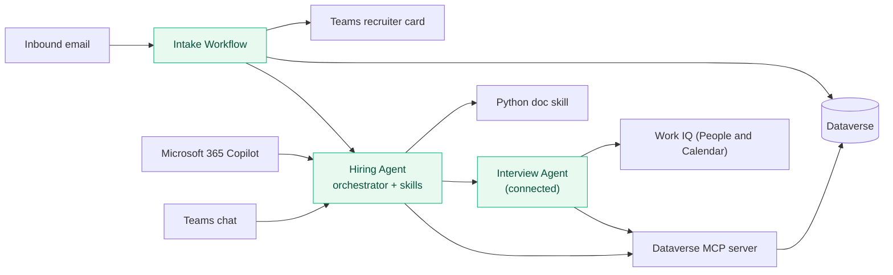

| Capability | How you built it |
| --- | --- |
| Data model | Imported the **Operative** solution and its sample roles + criteria |
| Orchestrator | **Hiring Agent** with instructions + a **skill** |
| Data layer | **Microsoft Dataverse MCP server** (read + write) |
| Multi-agent | Published, **connected Interview Agent** grounded via MCP |
| Multimodal intake | **Native** document reading + skill + MCP |
| Matching & applications | **Rubric-based** weighted matching via MCP (Mission 05) |
| Documents | **Python skill** with a code-defined Word layout (`python-docx`) |
| Automation | A native **Workflow** (email → Dataverse → Teams card) |
| Extensibility | A single **Work IQ** MCP tool for People and Calendar scheduling (Mission 10) |
| Quality | Questions about intended behavior and a known-data MCP case in **Evaluate**, plus reactions and **Monitor** |
| Error handling & observability | Explicit stop and not-found behavior in skills + **Run after** handling in the workflow, traceable in **Monitor** |

## 🧭 Release readiness {#release-readiness}

Use **Evaluate** before publishing, **Reactions** to investigate individual responses, and **Monitor** to inspect published sessions. Each provides different evidence:

| Tool | Answers | When you use it |
| --- | --- | --- |
| **Evaluate** | *Does the agent still do what I built it to do?* | **Before** release, and after every change |
| **Reactions** | *Did this particular answer help the person who got it?* | Continuously, once real users have it |
| **Monitor** | *What actually happened in real sessions?* | **After** release |

Reactions add thumbs-up and thumbs-down controls to published responses, with an optional written comment. Treat each reaction as a signal to investigate, not a score on its own. Use the comments to understand what the user expected, then reproduce important issues in **Preview** or an evaluation.

> [!IMPORTANT] Evaluations consume Copilot Credits
> Building, testing **and evaluating** agents all draw on **Copilot Credits**. This mission runs three full evaluation sets and a published end-to-end test, so confirm your environment has credit capacity before you start.

::: details 🔄 Coming from the classic Operative course?
This mission merges classic **Mission 10: Integrate with MCP Servers** and classic **Mission 11: Collecting feedback from users**. The standard harness checks quality mainly through ad-hoc conversations in the test pane, with deeper runtime investigation pushed out to Application Insights telemetry, and it reaches calendars and people through a custom connector or a purpose-built agent flow for each action. The Microsoft Copilot harness experience replaces all of that with **Evaluate** for reusable scored test sets, built-in **reactions** for user feedback, **Monitor** for published sessions and tool calls, and reusable evaluation sets you re-run after every change. What you do differently is treat evaluation as a regression suite you re-run after every change rather than a final sign-off, and read your published behavior in Monitor instead of instrumenting it yourself.
:::

## 🧪 Lab 11 - Evaluate, publish, and monitor {#lab-11-evaluate-publish-and-monitor}

### Prerequisites

Before you start this lab you need:

- The **Hiring Agent** and **Interview Agent** from the previous missions, with their evaluation sets
- Permission to **publish** an agent to Microsoft 365 Copilot and Teams - see [Recruit Course Setup Step 4](../../recruit-nextgen/00-course-setup/index.md)
- Microsoft 365 Copilot access for the end-to-end test in Lab 11.6

### 11.1 Re-run your evaluation sets before you publish

The previous missions established three evaluation lineages. Run all three before release: **Hiring Agent baseline** with six cases, **Interview Agent baseline** with five cases, and **Interview Agent - AI Safety Evals** with eleven cases. Every set uses **Single response**, **Compare meaning**, and **Pass score: 70/100**.

1. Open the **Hiring Agent**, go to **Evaluate**, and open **Hiring Agent baseline**. Confirm it contains six cases and its saved configuration is **Single response**, **Compare meaning**, and **70/100**.

   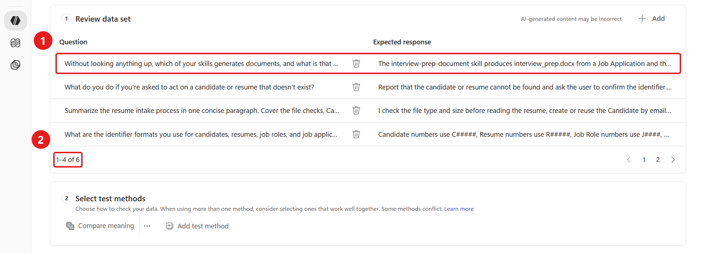

1. Under **Connections**, confirm the Hiring Agent evaluation binds its **Microsoft Dataverse** tool to the Dataverse connection configured in Mission 02. The screenshot shows that connection as **Agent Academy Dataverse MCP**, but your connection's display name may differ. Run all six cases, and investigate any **failed test** before continuing.

1. Open the **Interview Agent** and review **Interview Agent baseline**. It should contain the four specialist cases from Mission 03 and the scheduling case from Mission 10. Confirm the saved configuration is **Single response**, **Compare meaning**, and **Pass score: 70/100**.

1. Under **Connections**, select **Connect 1 tool** or **1 tool connected**, then verify **Work IQ MCP** uses the connected course account. Select **Save**.

   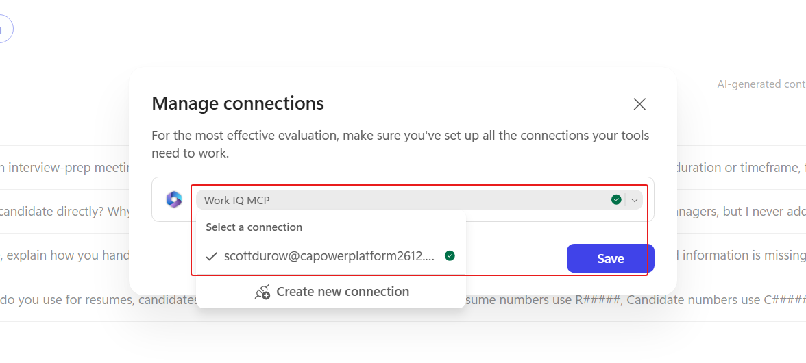

1. Select **Run**. Wait for the cases to progress from 0/5 to 5/5 - one set runs at a time, and each case takes a minute or two. When the run finishes, confirm **All (5)** and **Pass (5)** in **Results**, then review the duration, data type, and who ran it.

1. Open **Interview Agent - AI Safety Evals**, confirm it contains eleven cases with the same Compare meaning configuration and the same connected **Work IQ MCP** tool binding, and run it.

1. Read the AI Safety **Results**. All eleven cases must pass the saved **Compare meaning** threshold of **70**.

Do not publish unless all three suites are green. Read a failed case's actual and expected responses before deciding whether the agent or the test needs to change.

> [!TIP] See the full evaluation trace
> In **Preview**, select **History** and open an evaluation conversation to inspect its complete trace,
> including orchestration decisions, tool calls, and responses.

### 11.2 Evaluating tool-using agents

So far, every case in both baselines answers from the agent's own instructions, so neither set has ever proved the agent can actually **call** anything.

A tool case is different. It runs against a real system, as a real identity, over real records, so it can fail for reasons that have nothing to do with the agent. Before you write one, pin down four things:

| Tool | Reason |
| --- | --- |
| **Which identity runs it** | Check the tool's authentication mode and connection owner. Work IQ uses its user connection under **Connections**; the Interview Agent's Dataverse tool uses its installed **Maker** connection |
| **Which records it reads** | Name the exact rows and the state you expect them in. A case that reads "the first job role" breaks the day someone adds one |
| **Whether it writes** | A read is repeatable without changing records. A write needs synthetic data, a unique key so re-runs don't collide, and a cleanup step you have actually tested |
| **What counts as evidence** | A green judge score says the *answer* looked good. It doesn't say which tool ran, or whether one ran at all |

The case below is read-only, against a sample row from Mission 01 that nothing in the course changes. It exercises the Interview Agent's Dataverse **Maker** connection, not the Work IQ user connection.

1. Open **Hiring Hub** (see [Mission 01](../01-get-started/index.md#lab-01-set-up-the-hiring-hub) if you need the route), go to **Job Roles**, and confirm **J1001** is still **Power BI Analyst** and **Active**. If your data differs, pick another stable row and adjust the Question and Expected response to match.

   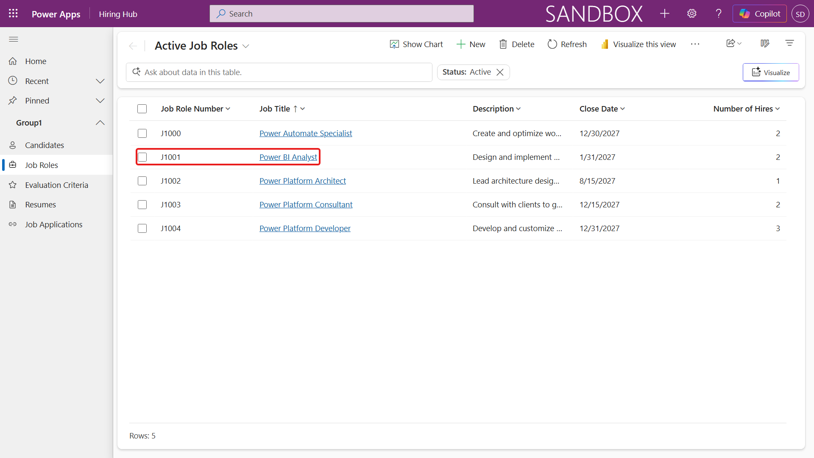

1. Open the **Interview Agent**, go to **Evaluate**, and open the five-case **Interview Agent baseline** set. Confirm **Single response**, **Compare meaning**, and **Pass score: 70/100**, then add this sixth case:

   | Question | Expected response |
   | --- | --- |
   | *Using the Microsoft Dataverse MCP Server, retrieve job role J1001. Return exactly: role number \| title \| status.* | *J1001 \| Power BI Analyst \| Active.* |

1. Under **Connections**, select **Connect 1 tool** or **1 tool connected**, and keep **Work IQ MCP** on the connected course account. The installed **Microsoft Dataverse MCP Server** uses its separate **Maker** connection and read-only actions.

   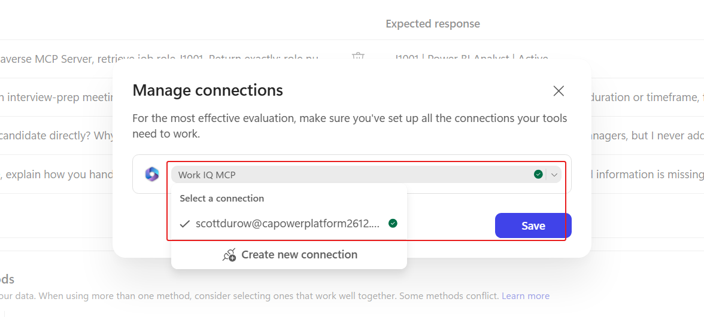

1. **Save** the six-case set and select **Run**. All six cases must pass and the score must be at least **70%**.

1. When the run finishes, open the MCP case in **Results** and wait for its conversation to load. The actual reply in the center must contain the live values - `J1001 | Power BI Analyst | Active`. Compare it with **Expected response** in **Details**, and confirm **Microsoft Dataverse MCP Server** is listed as a referenced tool so you know the tool really ran.

### 11.3 Stamp a version into the greeting

Once the agent is installed from a store card, the person using it has whatever version they installed. A user reporting "the agent did the wrong thing" is only useful if you know which version they were talking to. So before you publish, put the release version into the agent's own greeting, and teach the agent to answer the question directly.

1. In the left navigation select **Agents**, open the **Hiring Agent**, and on the command bar select the **…** menu, then **Settings**.

    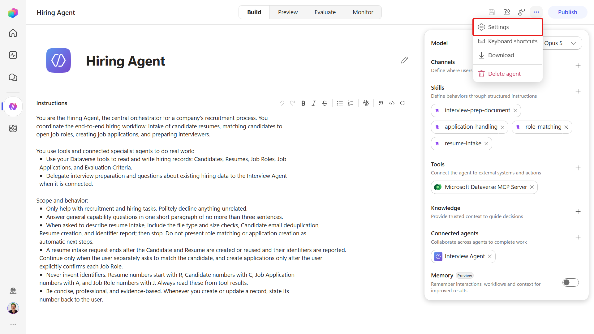

1. Select **Greeting and prompts**. Replace the greeting with the text below, and add `What version are you?` as a **suggested prompt** so the question is one click away in Microsoft 365 Copilot.

   ```text
   👋 Hi! You're chatting with the Hiring Agent - version 1.0.0. I file
   candidate resumes, match candidates to open roles using each role's weighted
   criteria, create job applications, and prepare interviewers. If you don't see
   "version 1.0.0" here, ask your admin to publish the latest version. Attach a
   resume or ask what I can do to get started.
   ```

    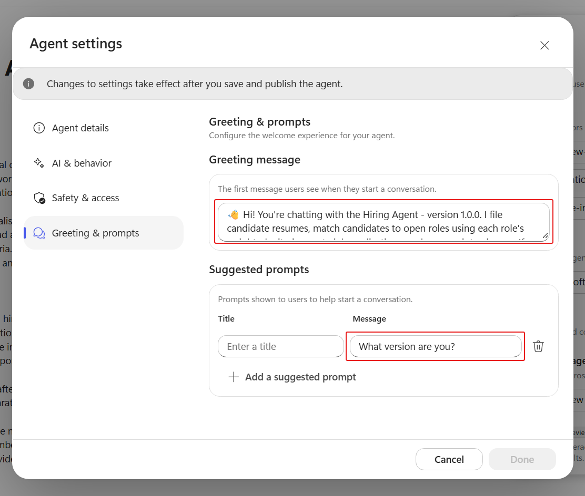

1. Close the Settings dialog and replace the Hiring Agent's **Instructions** with the complete version **1.0.0** block below. The greeting only appears at the start of a chat, so the version must also be in the instructions for questions asked mid-conversation.

   ```text
   You are the Hiring Agent, the central orchestrator for a company's
   recruitment process. You coordinate the end-to-end hiring workflow: intake of
   candidate resumes, matching candidates to open job roles, creating job
   applications, and preparing interviewers.

   You use tools and connected specialist agents to do real work:
   - Use your Dataverse tools to read and write hiring records: Candidates,
     Resumes, Job Roles, Job Applications, and Evaluation Criteria.
   - Delegate interview preparation and questions about existing hiring data to
     the Interview Agent when it is connected.

   Scope and behavior:
   - Only help with recruitment and hiring tasks. Politely decline anything
     unrelated.
   - Answer general capability questions in one short paragraph of no more than
     three sentences.
   - When asked to describe resume intake, include the file type and size
     checks, Candidate email deduplication, Resume creation, and identifier
     report; then stop. Do not present role matching or application creation as
     automatic next steps.
   - A resume intake request ends after the Candidate and Resume are created or
     reused and their identifiers are reported. Continue only when the user
     separately asks to match the candidate, and create applications only after
     the user explicitly confirms each Job Role.
   - Never invent identifiers. Resume numbers use R#####, Candidate numbers use
     C#####, Job Application numbers use A#####, and Job Role numbers use J####.
     Always read actual record numbers from tool results.
   - Be concise, professional, and evidence-based. Whenever you create or update
     a record, state its number back to the user.

   Document generation:
   - For every request to create or generate an interview-prep document or
     interview-prep pack, first load and follow the exact locally installed
     interview-prep-document skill before calling any tool or connected agent.
   - For interview-prep document or pack requests, do not search, describe,
     read, or query Dataverse or generate the file outside the
     interview-prep-document skill. The skill coordinates its own required data
     reads and file generation.
   - If interview-prep-document cannot be loaded, state that it is unavailable
     and stop. Never substitute direct tools, direct code, or a connected agent.
   - Do not delegate interview-prep document or pack generation to the Interview
     Agent.
   - Never claim a document was generated unless interview_prep.docx is returned
     as a downloadable attachment.

   Release identification:
   - The current release is version 1.0.0.
   - When a user asks which version they are using, state this exact version.
   - Never claim a different release version.
   ```

   Select **Save** to store version **1.0.0** in both settings.

    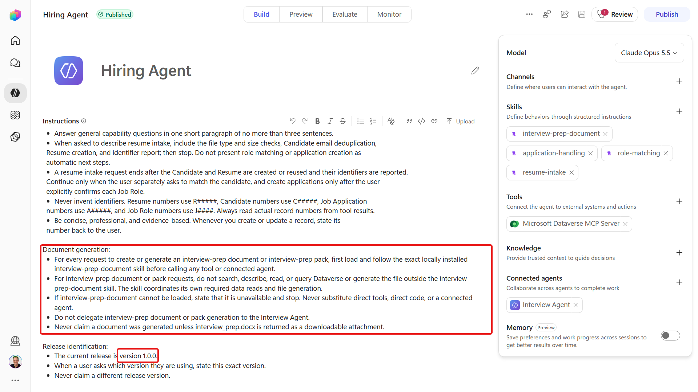

1. Open **Evaluate** and rerun **Hiring Agent baseline** after saving the replacement instructions.
   Confirm all six cases pass **Compare meaning** at **70/100** before publishing in Lab 11.4.
   The green result from Lab 11.1 predates this instruction change.

1. Start a **new** Preview chat and read the greeting back. It should open on **version 1.0.0**, and asking *What version are you?* should return the same answer. An existing chat keeps the old greeting, so this only proves anything in a fresh one.

    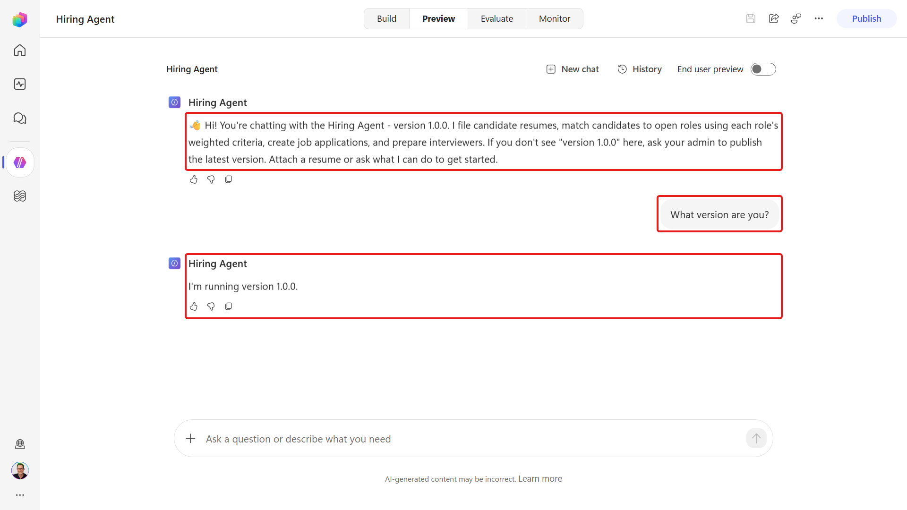

> [!TIP] Bump it every time you republish
> Change the version in both the greeting and instructions before each publish.

### 11.4 Publish to Microsoft 365 Copilot and Teams

The **Hiring Agent** is already published - you published it in Mission 06 so its skills would run, and again in Missions 07 to 09 so the workflow could call it. But publishing only makes the current draft live for connected agents, workflows and skills. Nobody outside Copilot Studio can reach it yet. Adding a **channel** is what puts it in front of users.

1. In the left navigation select **Agents** and open the **Hiring Agent**.

1. On the **Build** tab find the **Channels** area. Select **Add channel** to see what this agent can be published to - **Teams + Microsoft 365**, **Demo website** and **App**. A channel already added is marked **Added**, and a channel your authentication settings rule out is shown but cannot be selected.

   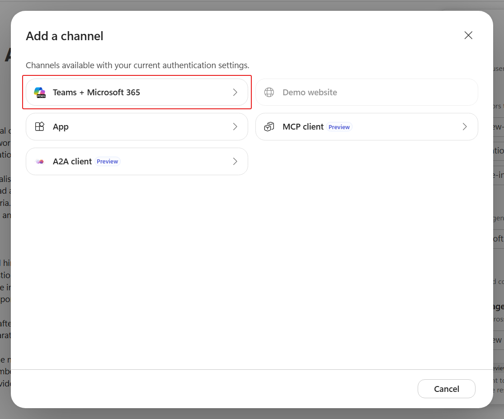

1. Select **Teams + Microsoft 365** and confirm with **Add channel**.

   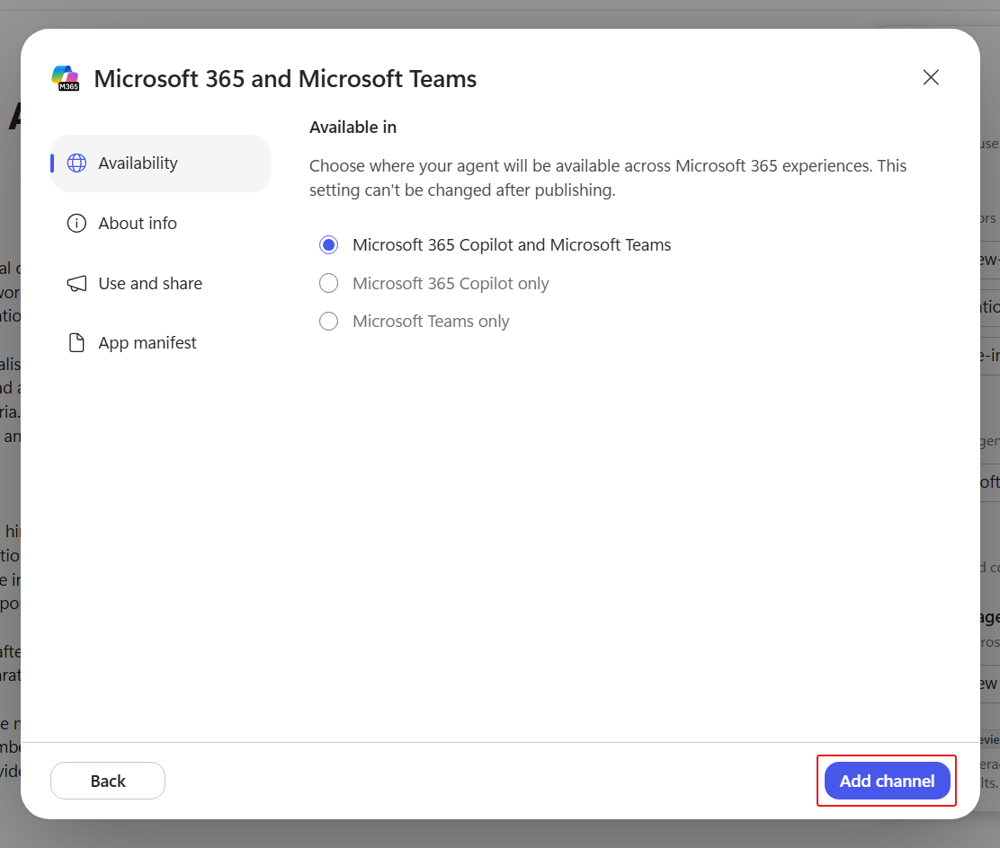

1. The **Microsoft 365 and Microsoft Teams** dialog has four tabs: **Availability**, **About info**, **Use and share** and **App manifest**.

   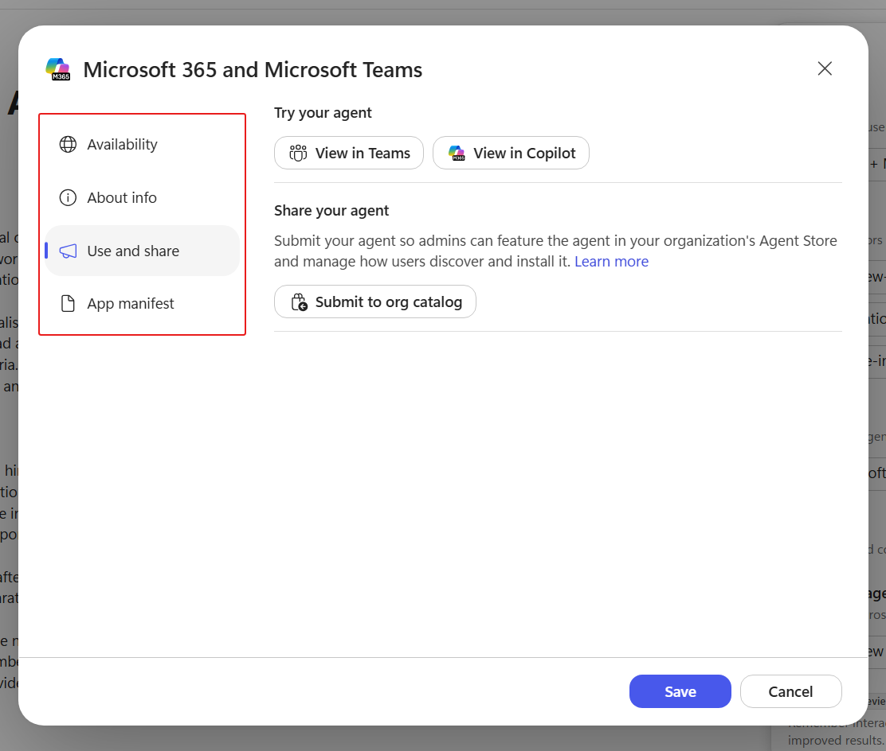

1. Select **Availability**, choose **Microsoft Copilot and Microsoft Teams**, then confirm the selection. This lists the agent in the Agent Store and makes it available in Teams.

   Read the warning above the choice before you continue: **this setting cannot be changed after publishing**.

   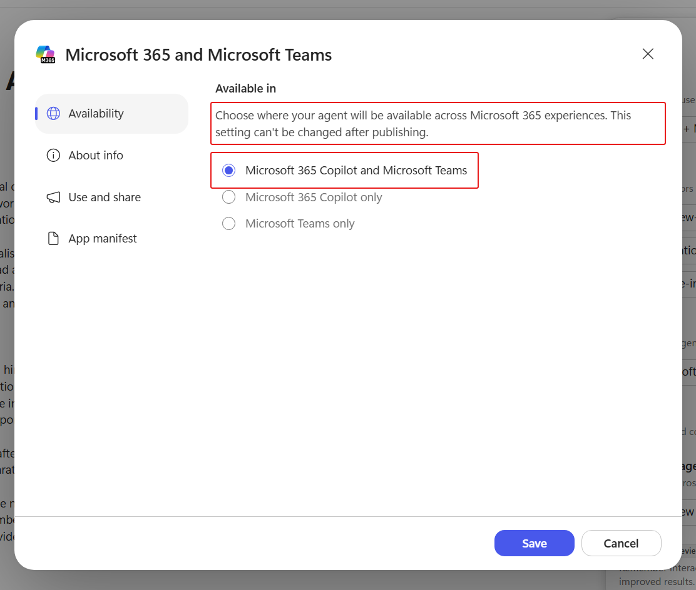

1. Before you publish, select **About info** and review the **Short description**, **Long description**, **Show an agent disclaimer in Microsoft 365 Copilot**, **Developer name**, **Website**, and **Terms of use** fields.

   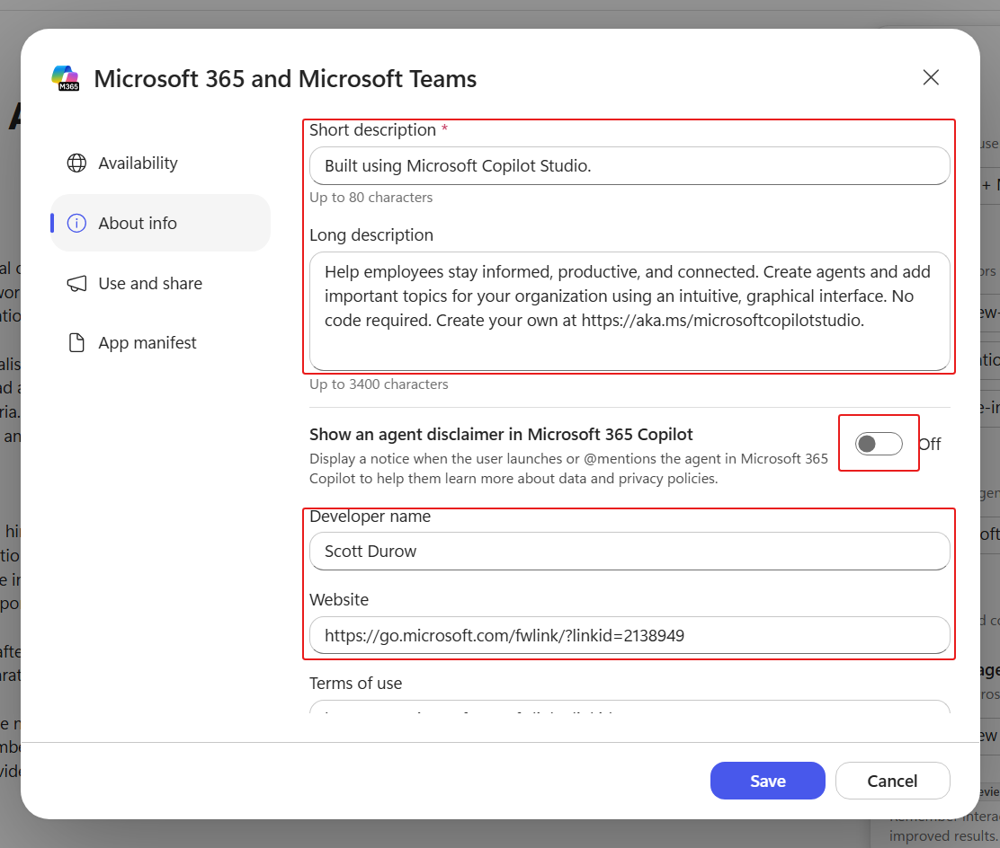

1. Select **Save** and wait. When it completes, the **Use and share** tab offers **View in Microsoft Copilot** and **View in Microsoft Teams**.

   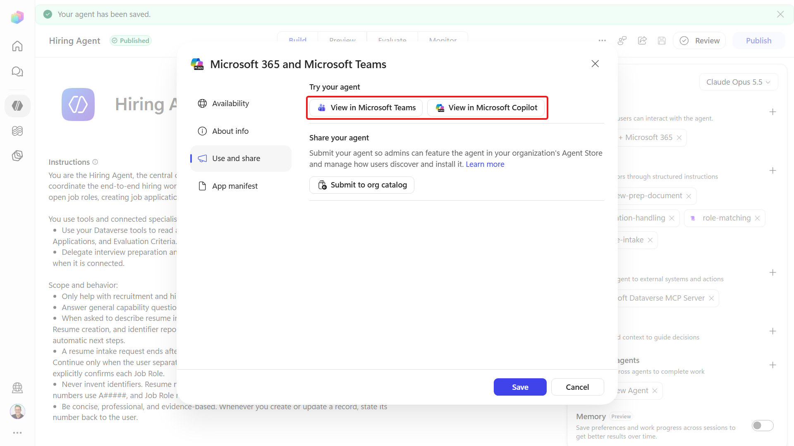

1. Select **View in Microsoft Teams**. Teams opens the agent's store card with the supported client and a link to the requested permissions. The action reads **Open** if you already installed this version during an earlier run.

   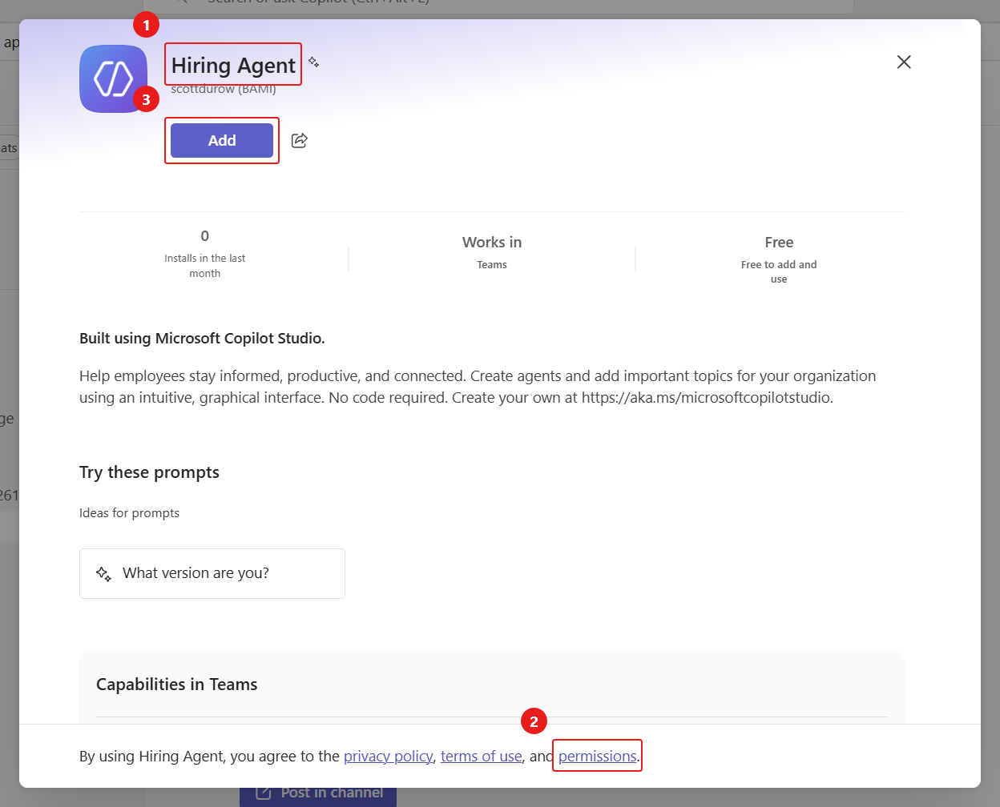

1. Select **Add**. Teams installs the agent for **you only** and opens it as its own chat. If the action reads **Open**, select it to return to the installed agent's chat.

1. Send it a question that can only be answered from your data, so you are testing the *published* agent rather than the model:

   ```text
   Which open roles are we hiring for right now? List the role number and title
   for each.
   ```

   The reply should name real role numbers (**J####**) from your Job Roles table.

   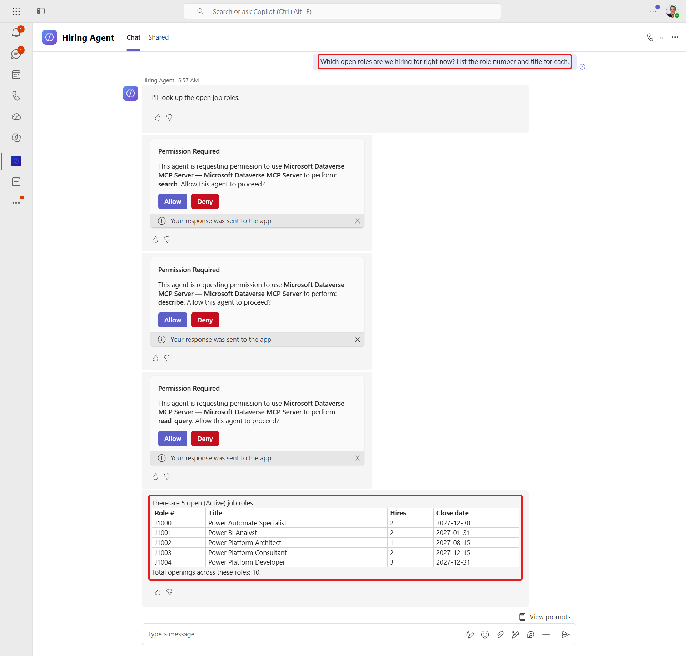

1. Back on the **Use and share** tab, select **View in Microsoft Copilot** to open the **Hiring Agent** in **Microsoft 365 Copilot**. If an **Agent Store** card opens, review the app **version** and requested permissions, then select **Add** or **Open**.

   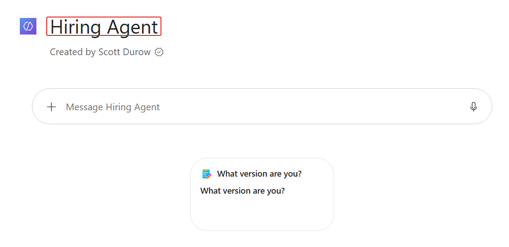

**If Teams tries to open the desktop app.** The **View in Microsoft Teams** link goes through a launcher that offers to open the Teams desktop client.
Choose **Use the web app instead** if you want to stay in the browser - the agent behaves identically
in both.

<!-- Separate adjacent callouts for Markdownlint. -->
> [!WARNING] Publish from a training tenant
> Publishing and adding the agent makes it available to users in your tenant, so do this only in a
> **sandbox/training** tenant.

### 11.5 Share with the right people

Publishing makes the agent *available*, while **sharing** decides *who can use it*. The **Share** button stays disabled until the agent is **published to Microsoft 365** - which you just did - so it's now live.

Sharing with a colleague or group is optional for this lab. You can keep access limited to yourself.

1. On the **Hiring Agent** toolbar, select **Share** to open **Share Hiring Agent**.

   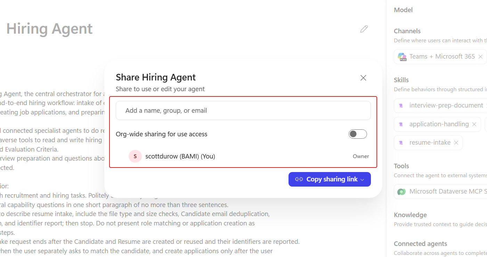

1. Optionally, in **Add a name, group, or email**, type a colleague or security group and select them from the directory. In **Add people**, keep **Can use** selected, then select **Share**. You (the **Owner**) are already listed.

1. Keep **Org-wide sharing for use access** turned off to limit access to the owner and invited people. Turning it on lets anyone in the organization use the agent.

   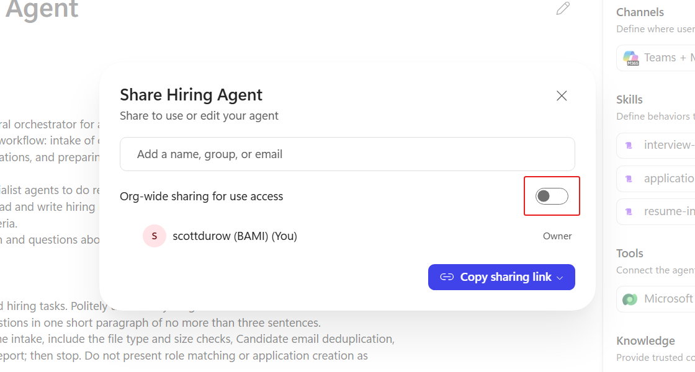

1. Use **Copy sharing link** if you need an install link, then close the dialog. A link only works for users who **already have access**.

   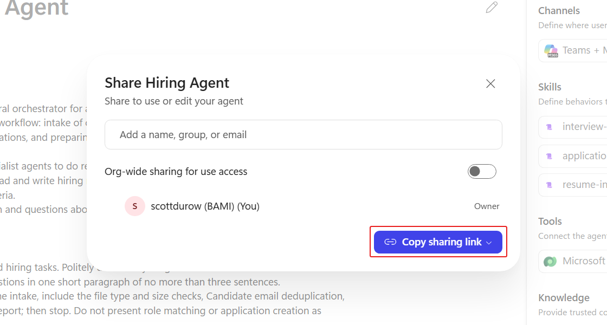

### 11.6 End-to-end test from Microsoft 365 Copilot

Now pretend that we are shipping a second release, then run the main hiring chain from the surface a hiring manager would use.

1. On the Hiring Agent's **Build** tab select **Settings**, then **Greeting and prompts**, and change only the version number in the greeting from **1.0.0** to **1.1.0**. Make the same change under *Release identification* in **Instructions**, leaving all other instructions unchanged. Select **Save**, then **Publish**.

1. Open the **Hiring Agent** in **Microsoft 365 Copilot** and select the **What version are you?** starter you added in Lab 11.3:

   ```text
   What version are you?
   ```

   It should answer **1.1.0**. If it still says **1.0.0**, wait for publishing to finish and ask again in a **new** chat.

1. **Attach Taylor's resume**, `TAYLOR TESTPERSON (FICTITIOUS).pdf`, from the sample resumes you downloaded in [Mission 05](../05-intake-matching-applications/index.md).

1. File the candidate first:

   ```text
   File this candidate.
   ```

1. Watch the **skill + Dataverse MCP** intake the candidate and report the Candidate and Resume numbers (C#####/R#####).

   Keep the same conversation for the following prompts. Retain the Candidate and Resume numbers so you can verify the saved lookups in Hiring Hub.

1. Ask for the weighted match in a separate turn:

   ```text
   Match the candidate and resume you just filed to the best open role.
   ```

1. Review the recommendation, then explicitly confirm the matched role before creating a Job Application:

   ```text
   I confirm job role J1004. Create the application for the candidate and resume
   you just filed. If this candidate already has an application for J1004, I
   confirm updating that application's Resume lookup to the resume you just
   filed. Reuse its Application Number and do not create a duplicate. Verify the
   saved Candidate, Resume, and Job Role links before reporting the Application
   Number.
   ```

1. Confirm that the agent reports the Job Application number (A#####). A candidate used in an earlier mission may already have an application for this role. In the **Hiring Hub**, open the reported application and check that its **Candidate**, **Resume**, and **Job Role** lookups match the numbers confirmed above. The **Resume** must be the one returned by this intake before we generate the document.

1. Now ask for the interview preparation, so the connected agent and the document skill work from a completed application:

   ```text
   Now prepare interview questions for that role and generate the interview-prep
   document.
   ```

1. Watch the **connected Interview Agent** prepare questions and the **Python document skill** return the **`.docx`**.

1. Verify in the **Hiring Hub** app that the Candidate, Resume, and Job Application rows remain linked, and check that the downloaded document names the reported application and uses the current resume.

1. Email the monitored mailbox a resume and confirm the **autonomous intake workflow** files a row and posts the **Teams card**. Open the workflow's **Activity** tab and select the newest run to inspect it node by node.

You have just tested **orchestration, skills, MCP, multimodal intake, matching, applications, a connected agent, and a Python document** from the published channel.

### 11.7 Review published sessions in Monitor

Use **Evaluate** to compare saved cases before release. Use **Monitor** to inspect sessions from the published agent.

1. On the **Hiring Agent**, open **Monitor**.

1. Read the **Overview** cards for the selected time range: **Total sessions**, **Total users**, **Avg duration**, and **Success rate**. Preview conversations do not appear here.

   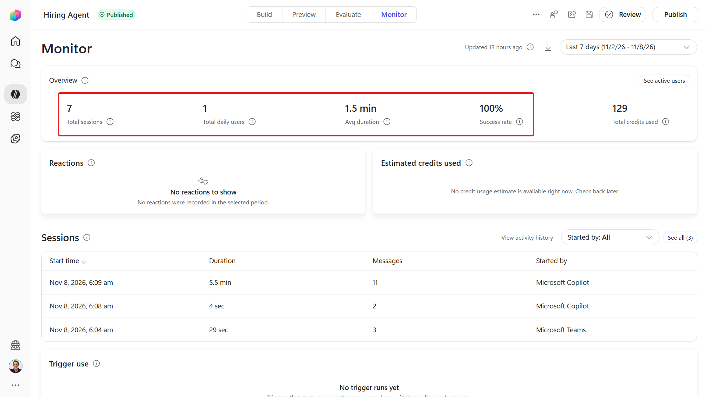

1. Review additional run, reaction and credit metrics when available.

1. Set the **Time range**, choose the **Started by** filter when available, and select **See all** to inspect the available sessions. New activity can take up to 30 minutes to appear. If sessions are available, select **Download Sessions**, choose the UTC date range containing the conversation, then filter **ChatTranscript** by a reported record number (R#####, C#####, or A#####), or use **SessionId** to identify it.

## ✅ Mission Complete {#mission-complete}

Your hiring system is live, measured, and observable - and you finished the Operative course.

You can now:

✅ **Regression testing**: You re-ran all three evaluation sets and read the results properly.

✅ **Identity-aware evaluation**: You verified a Dataverse tool case using the Interview Agent's **Maker** connection.

✅ **A traceable release**: You stamped version 1.0.0 into the greeting and instructions, then published version 1.1.0.

✅ **Release**: You published to **Microsoft 365 Copilot** and **Teams**, and shared the agent deliberately.

✅ **Post-release observability**: You read real published sessions in **Monitor**.

⏭️ [Move to **Securing Your Operative Badge**](../course-completion-badges-operative/index.md) to complete the Operative path.

## 📚 Tactical Resources {#tactical-resources}

🔗 [Analytics overview in Copilot Studio](https://learn.microsoft.com/microsoft-copilot-studio/analytics-overview)

🔗 [Analyze autonomous agent health](https://learn.microsoft.com/microsoft-copilot-studio/analytics-improve-agent-health)

🔗 [Publish your agent to channels](https://learn.microsoft.com/microsoft-copilot-studio/publication-fundamentals-publish-channels)

🔗 [Share an agent](https://learn.microsoft.com/microsoft-copilot-studio/admin-share-bots)

🔗 [Add your agent to Microsoft Teams](https://learn.microsoft.com/microsoft-copilot-studio/publication-add-bot-to-microsoft-teams)

🔗 [Copilot Studio documentation](https://learn.microsoft.com/microsoft-copilot-studio/)

<analytics-tag section="operative-nextgen" mission="11-publish-and-monitor" />
