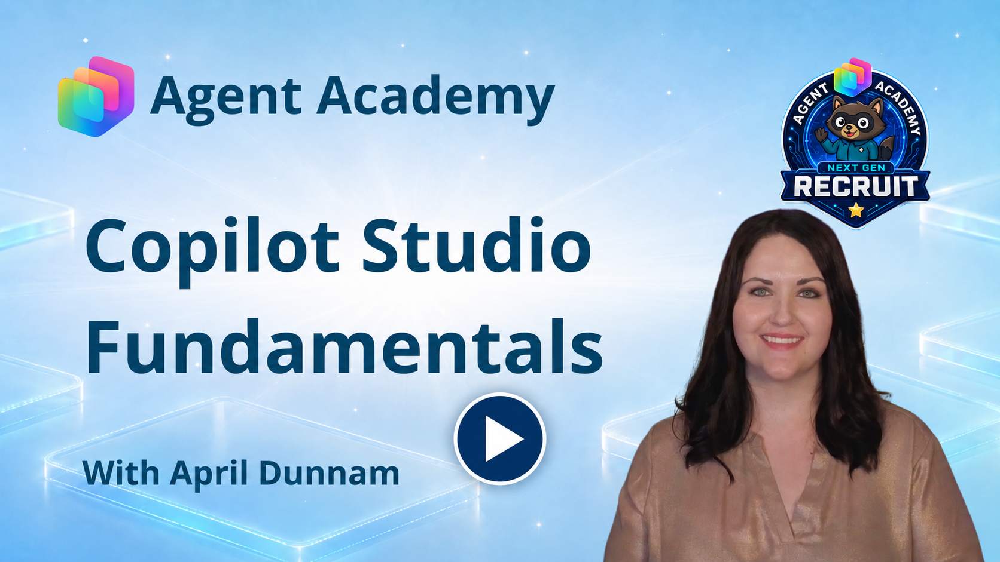
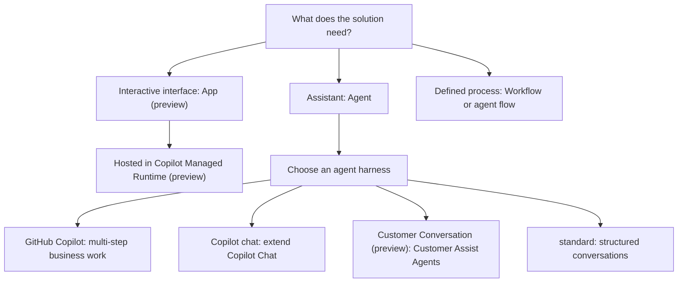

# 🛠️ Mission 02: Copilot Studio Fundamentals

<mission-meta />

🎥 **Watch the Walkthrough**

> [!NOTE] Product map updated October 22, 2026
> The recording predates the addition of apps and the Customer Conversation harness to this lesson. Use the written artifact and four-harness comparisons below for the current product map.

## 🎯 Mission Brief

In [Mission 01](../01-introduction-to-agents/index.md) you learned *how to think about agents*. This mission is the **toolbox**: what Microsoft Copilot Studio can build, how its four agent harnesses differ, and which building blocks you'll use on the **GitHub Copilot harness**.

Although we're not building yet, this mission is the map you'll keep open in another tab while you build, so the panels in the product line up with the ideas in your head.

The foundational concepts covered here matter because the same business request can lead to very different designs. A knowledge question, a repeatable approval, and a multi-step support task don't need the same harness or capability. By learning the platform vocabulary now, you'll be able to make deliberate choices when the `Contoso IT Concierge` solution begins using organizational knowledge, SharePoint tools, reusable skills, and workflows in later missions.

> [!IMPORTANT] This course builds an agent on the GitHub Copilot harness
> Copilot Studio offers **GitHub Copilot**, **Copilot chat**, **Customer Conversation**, and **standard** agent harnesses. It also supports app creation and workflow automation. This course builds the `Contoso IT Concierge` agent on the **GitHub Copilot harness**; you don't need to create an app or a Customer Assist Agent to complete it.
>
> Here, **GitHub Copilot harness** means the agent runtime in Copilot Studio, not the GitHub Copilot coding assistant. Follow this course's setup instructions for the required authoring experience.

## 🔎 Objectives

By the end of this mission you'll be able to:

1. Distinguish **apps**, **agents**, and **workflows**, and place Copilot Studio in the Microsoft ecosystem
1. Compare the four agent harnesses and explain why this course uses **GitHub Copilot**
1. Identify the GitHub Copilot harness building blocks, including instructions, knowledge, tools, skills, and connected agents
1. Choose when a defined workflow should handle part of an agent-driven process
1. Recognize that publishing, governance, and billing depend on the artifact and harness

## What Copilot Studio Is (and Isn't)

**Microsoft Copilot Studio** is a low-code studio for building and managing business solutions with **agents**, **workflows**, and an **app creation experience in preview**.

Think of it as a workshop with different workstations, not a single chatbot designer:

- **Apps** give people an interactive interface to use.
- **Agents** interpret requests, answer questions, and use configured capabilities to act.
- **Workflows and agent flows** coordinate defined steps, conditions, tools, and review points.

Copilot Studio connects these experiences to organizational data and services. The capabilities, governance surface, and lifecycle depend on what you're building; don't assume one artifact's environment, publishing, or billing instructions apply to another.

> [!INFO] The repositioning that matters
> On the GitHub Copilot harness you don't script conversation paths. You **describe** the agent, point it at knowledge, give it skills and tools, and let the harness reason through the goal. The skills that pay off are **writing clear instructions and choosing the right capabilities**, not drawing dialog trees.

## First Decision: What Are You Building?

Start with how people need to do the work.

| Need | Start with | IT support example |
| --- | --- | --- |
| People need screens, forms, or views they can return to | **An app (preview)** | An equipment-request tracker |
| People need an assistant to understand a request and help complete it | **An agent** | The `Contoso IT Concierge` |
| A process needs defined steps and review points | **A workflow or agent flow** | Validate a request, obtain approval, and update the request record |

These are starting points, not exclusive choices. An agent can call a workflow, and a workflow can call an agent when a step needs reasoning.

Workflows on the GitHub Copilot harness and established agent flows on the standard harness have different authoring and execution models. Use the instructions for the artifact you're actually building; the names aren't interchangeable.

Start with the artifact people need, then choose an agent harness when an agent is part of the solution. Apps, agents, and workflows can be combined; this is a design map, not a complete execution architecture.

### Where Apps and Copilot Managed Runtime Fit

The app creation experience generates an interactive app from your description. You refine it, preview it, and publish and share it. **App creation is in preview**, is gradually rolling out, and can be disabled by your administrator.

Apps created this way run in **Copilot Managed Runtime (preview)**: Microsoft-hosted app infrastructure with Microsoft Entra authentication and organizational governance. Users find the apps available to them at [managedapps.cloud.microsoft](https://managedapps.cloud.microsoft/).

App creation is powered by the GitHub Copilot harness, but the resulting app is a different artifact from an agent. **Copilot Managed Runtime isn't a fifth agent harness.**

> [!IMPORTANT] Three meanings of "app"
> A **managed app created in Copilot Studio** isn't the agent **App channel**, which delivers an agent experience. It also isn't a Power Apps **canvas app** or **model-driven app**. Those names refer to different artifacts and authoring experiences.
>
> Studio routes app creation to a personal environment automatically. Don't apply this course's agent solution-packaging steps to a managed app. App build and runtime billing also need their own guidance.

Learn more in [Apps overview](https://learn.microsoft.com/en-us/microsoft-copilot-studio/apps-experience/apps-overview) and [Copilot Managed Runtime overview](https://learn.microsoft.com/en-us/microsoft-365/managed-apps/).

## Second Decision: Which Agent-Building Surface? {#second-decision-which-agent-building-surface}

If an **agent** is the right starting point, Copilot Studio isn't the only place to build one. This comparison concerns agent-building surfaces, not every way to create an app:

> **Microsoft 365 Copilot (consume) → Agent Builder → Copilot Studio → Microsoft Foundry**
> *no build · no-code · low-code · pro-code*

| | **Agent Builder** *(in Microsoft 365 Copilot)* | **Copilot Studio** | **Microsoft Foundry** |
|---|---|---|---|
| **Build style** | No-code, natural language, in-context | Low-code → pro-code | Code-first / pro-code |
| **Who it's for** | Information workers | Makers & developers | Developers & engineers |
| **Reach** | **Microsoft 365 Copilot only** (you/your team) | Department, organization, or external—Teams, web, voice, custom apps | Custom apps (can publish to Microsoft 365 Copilot) |
| **What it builds** | Lightweight Q&A agents grounded in your Microsoft 365 content | Business agents, workflows, and agent flows; app creation is also available in preview | Custom AI applications, orchestration, models, and infrastructure |
| **Governed in** | Microsoft 365 admin center | Depends on the artifact: Power Platform administration for agent environments; managed-app oversight also uses Microsoft 365 administration | Azure (RBAC, Entra Agent ID, Foundry control plane) |
| **Time to value** | Immediate | Days to weeks | Weeks to months |

This illustration compares **agent-building surfaces**. It isn't a catalog of managed-app creation routes.

### Agent Builder: Copilot Studio's lightweight cousin

This is the one most people get confused about. **Agent Builder** lives *inside* the Microsoft 365 Copilot app (in Copilot Chat, Teams, and microsoft365.com). It provides a simple way to build agents that extend Microsoft 365 Copilot Chat through the **Copilot chat harness**. No separate portal, no code, no broad publishing: you describe an agent in natural language, point it at public websites or Work IQ content, and it's live for you or your team in minutes. It's governed from the **Microsoft 365 admin center**.

> [!NOTE] Learn Agent Builder in Copilot Developer Camp
> Agent Builder isn't part of this course's hands-on path. To build one yourself, complete [Declarative Agent Foundation with Agent Builder](https://microsoft.github.io/copilot-camp/pages/extend-m365-copilot/01-first-agent-builder/), a Copilot Developer Camp lab covering creation, grounding, testing, and governance basics.

<!-- Separate adjacent callouts for Markdownlint. -->

> [!TIP] Move to Copilot Studio when the requirements grow
> Start in **Agent Builder** when the job is "a focused agent over our content, for our team." Choose **Copilot Studio** when you need broader publishing, multi-step workflows, custom connectors, or end-to-end business automation. Treat that move as an architecture decision; don't assume every Agent Builder configuration or capability transfers directly.

### When to move to Foundry instead

Go the *other* direction, past Copilot Studio to **Microsoft Foundry**, when you need **code-first control over orchestration**, your own **model and inference stack**, an **Azure data boundary**, or you're building a **custom AI application** rather than a business agent. Foundry can still publish to Microsoft 365 Copilot, so "pro-code" doesn't mean "leaves the ecosystem." *(Beyond Foundry, Microsoft also provides SDK options such as Microsoft Agent Framework and the Microsoft 365 Agents SDK. Use these when you want full code ownership; that's a deeper dive than this mission.)*

## Third Decision: Which Agent Harness? {#third-decision-which-agent-harness}

Mission 01 introduced a useful distinction:

- The **model** provides reasoning and language generation.
- The **harness** is the runtime environment around the model. It controls which components are available, what context reaches the model, how responses are interpreted, how tools are called, and how execution is managed.
- **Orchestration** is the decision-making approach inside the harness. It directs what the agent does next.

A harness is therefore broader than orchestration. It includes an orchestration approach along with capabilities such as tools, memory, skills, file handling, monitoring, and secure execution.

For an agent, choose the harness that fits the work. These are four agent options, not four versions of the same authoring experience.

| Harness | Best fit | Example | Course coverage |
| --- | --- | --- | --- |
| **GitHub Copilot** | Reasoning-heavy, multi-step work across tools, files, and business processes | An IT concierge that investigates a request and coordinates the next steps | This course's hands-on path |
| **Copilot chat** | Extending Microsoft Copilot Chat with enterprise knowledge | A policy assistant inside employees' everyday Copilot experience | Conceptual overview only; no hands-on lab |
| **Customer Conversation (preview)** | Customer-facing chat and voice, specialist handling, and human escalation | A **Customer Assist Agent** for billing questions and service issues | Conceptual overview only; no hands-on lab |
| **standard** | Structured conversations and maker-authored topics, with classic or generative orchestration | Guided troubleshooting with defined questions and branches | The separate standard harness course |

Customer Assist Agents can coordinate specialist sub-agents and escalate unresolved issues to human representatives. Their chat and speech capabilities differ: speech doesn't support end-user sign-in, so knowledge requiring end-user credentials is limited to chat.

The standard harness remains supported. Customer Conversation isn't a new name for every existing voice agent, and choosing GitHub Copilot doesn't mean an existing standard agent can be transferred directly.

For current capabilities and billing references, use the [harness comparison](https://learn.microsoft.com/en-us/microsoft-copilot-studio/harnesses-overview) and [Customer Conversation overview](https://learn.microsoft.com/en-us/microsoft-copilot-studio/agents-experience/overview-customer-conversation).

### Apply the Decision to IT Support

The same business scenario can require different artifacts and harnesses:

| If the solution needs to... | Consider... |
| --- | --- |
| Give employees a request form and status views | **An app (preview)** |
| Answer questions grounded in internal policies inside Copilot Chat | **Copilot chat harness** or Agent Builder |
| Guide an employee through authored troubleshooting questions and branches | **standard harness** |
| Interpret varied requests and combine guidance, live data, skills, and workflows | **GitHub Copilot harness** |
| Handle customer-service conversations over chat or voice with specialist handling and escalation | **Customer Conversation harness (preview)** |
| Run a defined approval and record-update sequence | **A workflow or agent flow**, using the relevant authoring path |

In this course, the `Contoso IT Concierge` uses the **GitHub Copilot harness**. It interprets an employee's request, selects capabilities, gathers missing information, and invokes a workflow when the request is ready. The other options help you recognize different requirements; they aren't extra builds required for your Recruit badge.

## Why is it called the "GitHub Copilot" Harness

You may be wondering why it's called the **GitHub Copilot harness**.

The name reflects the orchestration technology used by the harness which is built around the Github Copilot SDK. It does **not** mean your agent runs inside GitHub Enterprise Cloud or requires GitHub services to function.

When you build an agent using the GitHub Copilot harness:

- Your agent remains a Microsoft Copilot Studio agent
- Your agent is managed within Copilot Studio
- Your agent follows the governance model of your Copilot Studio environment

You do **not** need:

- A GitHub Copilot subscription
- A GitHub Enterprise Cloud deployment
- GitHub-specific administration or governance

The harness determines how an agent plans, reasons, and executes work. Copilot Studio continues to determine how the solution is built, governed, managed, and deployed.

## Why the GitHub Copilot Harness Is Different

The GitHub Copilot harness is designed for complex, **long-horizon work** where the path can't always be defined in advance. It runs an **agentic loop**: planning the work, taking action, reviewing the results, and adjusting its approach until it reaches the goal.

The difference isn't simply that it uses generative orchestration; the Standard harness can use generative orchestration too. The GitHub Copilot harness combines enhanced, goal-driven orchestration with a runtime and capability set designed for longer, more complex work.

This enables agents to:

- Reason through dynamic problems and ambiguous decision points
- Coordinate multiple tools across many steps and data sources
- Analyze files and business artifacts as part of a broader process
- Produce rich, multipart outputs instead of a single response
- Connect to tools and agents on other platforms

Microsoft's business-process evaluations showed performance and quality gains in multi-tool use, file analysis, code analysis, and knowledge quality when using the GitHub Copilot harness.

## The Anatomy of a GitHub Copilot Harness Agent

On the GitHub Copilot harness, an agent is organized around a handful of **core components**, all configured from the **Build** tab.

### 1. Instructions

The agent's standing brief: its **identity, personality, tone, scope, and behavioral rules**. On the GitHub Copilot harness there are no authored conversation trees to fall back on, so **instructions are your primary steering wheel**, they shape every plan the orchestrator makes. Write them like contracts, not suggestions.

### 2. Knowledge and Memory

The context the agent can draw on when it reasons and responds:

- **Connected knowledge sources** — SharePoint, OneDrive, Dataverse, websites, databases, and other sources. The agent retrieves relevant information from these sources to ground its answers, often with citations.
- **Memory** — Persistent context that helps the agent retain useful information across tasks and sessions instead of starting from scratch each time.

Connected knowledge and memory both provide context, but they serve different purposes. Knowledge lets the agent retrieve information from configured sources, while memory helps it retain relevant context over time.

### 3. Tools and Skills

The capabilities the agent can use to perform work:

- **Tools** let the agent perform actions such as calling an API, running a workflow, or connecting to an external MCP server. The orchestrator relies heavily on tool names and descriptions when deciding which capability to use.
- **Skills** define reusable, structured behaviors that the agent can invoke consistently instead of reasoning through the same task from scratch each time. Skills package focused instructions and capabilities for a particular kind of work.

> [!INFO] MCP, briefly
> **Model Context Protocol (MCP)** is an open standard for connecting agents to external tools and data. In Copilot Studio, MCP servers are added as tools so the agent can use capabilities beyond built-in connectors.

#### Work IQ

**Work IQ** is Microsoft's intelligence layer for grounding Copilot and agents in real-time organizational context. It connects signals from files, email, meetings, chats, calendars, and business systems through three layers: **Data**, **Memory**, and **Inference**.

In Copilot Studio, you add Work IQ as an **MCP tool**. This gives the agent access to relevant work context while respecting configured permissions, policies, and governance controls.

> [!IMPORTANT] Work IQ is in preview
> Work IQ in Copilot Studio is a preview capability powered by the GitHub Copilot harness. Its use is subject to usage-based billing through Copilot Credits. Work IQ is read-only unless an administrator explicitly enables write operations in the Microsoft 365 admin center.

### 4. Model

Choose the **AI model** that powers the agent's reasoning, including current GPT models and **reasoning models** for heavier planning. Match the model to the job: fast and economical for chat, reasoning for multi-step work.

### 5. Connected Agents

Specialized agents your agent can **delegate to**. Instead of one bloated agent that does everything, you compose a *team*: a coordinator hands subtasks to focused experts and stitches their results together.

### Related capability: Workflows

Workflows aren't a core component configured on the agent's **Build** tab. They're related automation artifacts that work alongside agents. An agent can invoke a workflow through a tool, and a workflow can include an agent node when one step requires AI reasoning.

Use workflows for deterministic, step-by-step parts of a process that must run consistently, such as approvals, payments, or record updates. You'll build one in [Mission 07](../07-automate-with-workflows/index.md).

> [!NOTE] Wait...what happened to Topics, Triggers, and branching?
> The **standard harness** supports authored **topics**, conversation paths, and branching logic. With classic orchestration, you control how requests route through them; with generative orchestration, an LLM can select among topics and other capabilities dynamically. The **GitHub Copilot harness** uses natural-language instructions and enhanced, goal-driven orchestration over knowledge, skills, tools, and connected agents. Neither is universally better: choose the harness that matches the work.

## Building on the GitHub Copilot Harness

Mission 01 covered the orchestration *idea*. Here's how it shows up when you build in Copilot Studio:

- **Natural-language-first, single surface.** You describe what you want; Copilot Studio generates the configuration. No topic inventory to maintain.
- **Goal-driven orchestration.** The GitHub Copilot harness can break a goal into steps, call the right capabilities, and adjust when a request changes or a step fails. You steer it through *instructions and capabilities*, not branches.
- **A tab-based workspace.** **Build** (identity, knowledge, tools, skills, model), **Preview** (test it interactively), **Evaluate** (run test sets to measure quality), and **Monitor** (review tasks, files accessed, and activity after you ship).

> [!TIP] How you actually steer the orchestrator
> Three dials, in order of impact: **(1)** tighten the **instructions**, **(2)** fix **tool/skill names and descriptions** so the planner picks the right one, **(3)** **remove** capabilities that are irrelevant or risky so they stop confusing it. A small, well-described toolkit beats an exhaustive, overlapping one every time. Use **Preview** to watch behavior live and **Evaluate** to keep it honest as you iterate.

## Workflows vs. Orchestration: Knowing When to Be Deterministic

The orchestrator is powerful *because* it decides at runtime. Sometimes that's exactly what you **don't** want.

> [!INFO] The opinionated heuristic
> **Reasoning for the ambiguous, workflows for the repeatable.** If you can draw the steps on a whiteboard and they never change, make it a **workflow**. If the path depends on what the user said or what the data shows, let the **orchestrator** plan it. Mixing the two, a deterministic workflow with an **agent node** for the one fuzzy step, is often the best answer.

## Channels: Where Your Agent Shows Up

Building an agent is half the job; **publishing it where people work** is the other half. Copilot Studio agents can surface in:

- **Microsoft 365 Copilot & Microsoft Teams** — the headline channels for this course.
- **Web** — embedded on a site or in a custom app.

You publish the agent at least once, then connect channels. *(Full walkthrough in Mission 08.)* Don't skip the design implications: an agent for a public website needs different guardrails than one for your internal Teams.

## Governance & ALM, at a Glance

You don't need to master this yet, but know the shape because "it works in my environment" is where agent projects go to die:

- **Solutions & environments** — Package your agent (and everything it depends on) into a **solution** so you can move it cleanly from dev to test to production. You'll learn more about this in [Mission 3](../03-creating-a-solution/index.md).
- **Identity & permissions** — Agents respect Microsoft 365 identity; users only ever see what they're allowed to. Work IQ enforces this at the platform level, per user.
- **Central oversight** — As an org's agent estate grows, **Microsoft Agent 365** acts as a control plane for inventory, permissions, behavior, and cost across the ecosystem.
- **Licensing** — Entitlements and billing depend on the artifact and harness. [Mission 09](../09-understanding-licensing/index.md) explains this course's GitHub Copilot agent and workflow requirements. Don't assume those rules also cover Customer Assist Agents or managed app build and runtime usage.

## ✅ Mission Complete {#mission-complete}

You've toured the Copilot Studio HQ. You can now:

✅ **Place Copilot Studio in the Microsoft ecosystem**: Explain how it connects Microsoft 365 Copilot, Power Platform, and Azure AI.

✅ **Choose an artifact**: Distinguish an interactive app, an agent, and a workflow or agent flow.

✅ **Choose an agent harness**: Match GitHub Copilot, Copilot chat, Customer Conversation, and standard to their intended scenarios.

✅ **Identify the GitHub Copilot harness building blocks**: Recognize instructions, knowledge, memory, tools, skills, models, and connected agents.

✅ **Steer the orchestrator**: Use clear instructions, well-named capabilities, Preview, Evaluate, and Monitor.

✅ **Choose deterministic or generative behavior**: Use workflows for repeatable processes and orchestration for ambiguous requests.

⏭️ [Move to **Creating a Solution**](../03-creating-a-solution/index.md) to start building the solution that will contain your agent and its components.

Stay sharp, Recruit, the toolbox is yours now.

## 📚 Tactical Resources

🔗 [Choose a harness in Copilot Studio](https://learn.microsoft.com/en-us/microsoft-copilot-studio/harnesses-overview)

🔗 [GitHub Copilot harness agents overview](https://learn.microsoft.com/en-us/microsoft-copilot-studio/agents-experience/overview)

🔗 [Apps in Copilot Studio (preview)](https://learn.microsoft.com/en-us/microsoft-copilot-studio/apps-experience/apps-overview)

🔗 [Customer Assist Agents and the Customer Conversation harness (preview)](https://learn.microsoft.com/en-us/microsoft-copilot-studio/agents-experience/overview-customer-conversation)

🔗 [Copilot Managed Runtime (preview)](https://learn.microsoft.com/en-us/microsoft-365/managed-apps/)

🔗 [Work IQ MCP overview](https://learn.microsoft.com/en-us/microsoft-copilot-studio/use-work-iq) — the intelligence layer, and how to add it

🔗 [Use the agent design framework](https://learn.microsoft.com/en-us/microsoft-copilot-studio/guidance/agent-design-canvas-framework) — a blueprint for scoping an agent before you build

🔗 [Connect an agent to Teams & Microsoft 365 Copilot](https://learn.microsoft.com/en-us/microsoft-copilot-studio/publication-add-bot-to-microsoft-teams)

🔗 [Copilot Developer Camp: Declarative Agent Foundation with Agent Builder](https://microsoft.github.io/copilot-camp/pages/extend-m365-copilot/01-first-agent-builder/) — hands-on Agent Builder lab

<analytics-tag section="recruit-nextgen" mission="02-copilot-studio-fundamentals" />
