---
tags:
  - mcp
difficulty: 3
time: 30
harness: github-copilot
description: >-
  Deploy an MCP Server and wire it up to Microsoft Copilot Studio.
badge: ./assets/MCP_Joker_Badge.png
products: [azure, copilot-studio, github-copilot, visual-studio-code]
industries:
  - it
created-date: 2026-02-20
last-edited-date: 2026-08-10
---
# 🤖 Microsoft Copilot Studio ❤️ MCP {#microsoft-copilot-studio-mcp}

<mission-meta />

<!-- markdownlint-disable-next-line MD033 -->
<p align="center">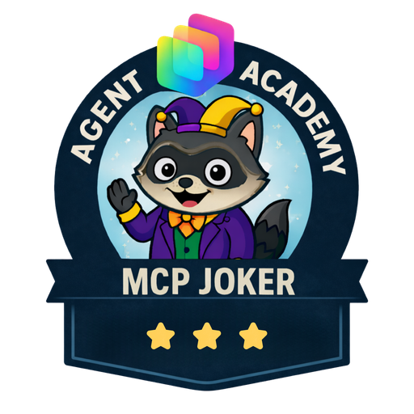</p>

Welcome, agent. Your mission — should you choose to accept it — is to deploy an **MCP Server** behind enemy lines and wire it up to **Microsoft Copilot Studio**. Expect turbulence. Trust the protocol. Leave no endpoint unconfigured. 🎯

> [!IMPORTANT] This mission uses the GitHub Copilot harness
> The Copilot Studio steps require an agent powered by the **GitHub Copilot harness**. Turn on **New Experience** before you create the agent. GitHub Copilot in Visual Studio Code is also used separately to test the MCP server.

## 🎯 Mission objectives {#mission-objectives}

In this mission, you'll learn how to:

- Run an MCP server locally or deploy it to Azure
- Connect and test the MCP server with GitHub Copilot in Visual Studio Code
- Add the MCP server to an agent powered by the GitHub Copilot harness in Copilot Studio
- Remove the Azure resources after completing the mission

## ❓ What is MCP? {#what-is-mcp}

[Model Context Protocol (MCP)](https://modelcontextprotocol.io/introduction) is an open protocol that standardizes how applications provide context to LLMs, defined by [Anthropic](https://www.anthropic.com/). MCP provides a standardized way to connect AI models to different data sources and tools. MCP allows makers to seamlessly integrate existing knowledge servers and APIs directly into Copilot Studio.

## 🆚 MCP vs Connectors {#mcp-vs-connectors}

When do you use MCP? And when do you use connectors? Will MCP replace connectors?

MCP servers are made available to Copilot Studio using connector infrastructure, so these questions are not really applicable. The fact that MCP servers use the connector infrastructure means they can employ enterprise security and governance controls such as [Virtual Network](https://learn.microsoft.com/power-platform/admin/vnet-support-overview) integration, [Data Loss Prevention](https://learn.microsoft.com/power-platform/admin/wp-data-loss-prevention) controls, [multiple authentication methods](https://learn.microsoft.com/connectors/custom-connectors/#2-secure-your-api)—all of which are available in this release—while supporting real-time data access for AI-powered agents.

So, MCP and connectors are really **better together**.

## ⚙️ Prerequisites {#prerequisites}

- Visual Studio Code installed ([download](https://code.visualstudio.com/download))
- Node v22 (ideally installed via [nvm for Windows](https://github.com/coreybutler/nvm-windows) or [nvm](https://github.com/nvm-sh/nvm))
- Docker installed ([download](http://aka.ms/azure-dev/docker-install))
- Azure Developer CLI installed ([download](https://learn.microsoft.com/azure/developer/azure-developer-cli/install-azd))
- Azure Subscription (with payment method added)
- Copilot Studio trial or developer account with access to the **GitHub Copilot harness**

> [!IMPORTANT] GitHub Copilot harness billing
> This mission uses the **GitHub Copilot harness in Microsoft Copilot Studio**, which uses usage-based billing. Building, testing in Preview, evaluating, and using the agent might consume **Copilot Credits**. Review the [Copilot Credits billing overview](https://learn.microsoft.com/microsoft-copilot-studio/agents-experience/billing-credit-overview) before you begin.

## 🧪 Lab 1.1 - Set Up the MCP Server {#lab-11-set-up-the-mcp-server}

Now you have a choice! You either run the server locally - or you can deploy it to Azure.

There are a couple of steps that you need to do for both:

1. Download the Jokes MCP Server

    <download-files path="special-ops/mcs-mcp/source" filename="jokes-mcp-server.zip" label="Download Jokes MCP Server" />

1. Extract `jokes-mcp-server.zip` into a folder named `jokes-mcp-server`. Keep all subfolders and configuration files together.

1. Open Visual Studio Code and open the unpacked folder

1. Open the terminal in Visual Studio Code by pressing `ctrl` + `` ` `` (Windows/Linux) or `cmd` + `` ` `` (Mac)

### 🏃‍♀️ Run the MCP Server Locally {#run-the-mcp-server-locally}

1. Run the following command to install the dependencies:

    ```bash
    npm install
    ```

1. Run the following command to build and start the server:

    ```bash
    npm run build && npm run start
    ```

    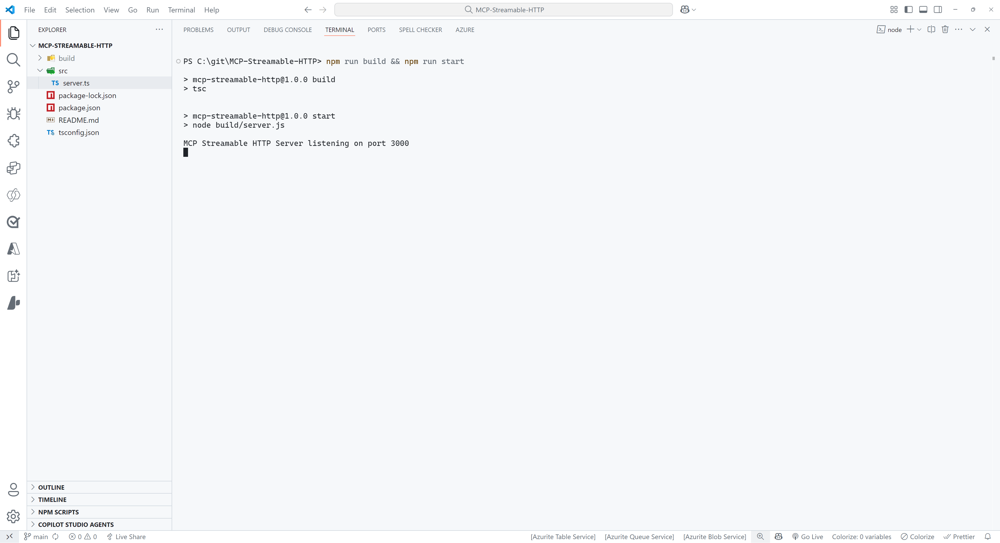

1. Select **PORTS** at the top of the Visual Studio Code Terminal

    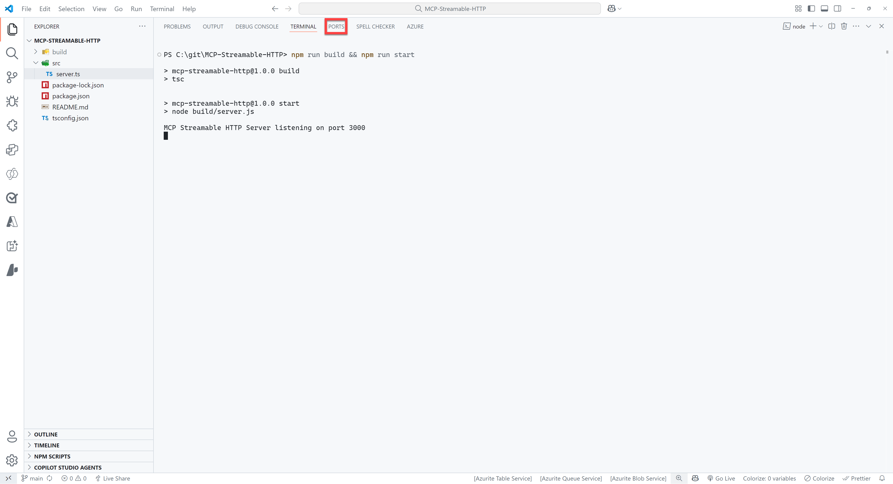

1. Select the green **Forward a Port** button

    

1. Enter `3000` as the port number (this should be the same as the port number you see when you ran the command in step 5). You might be prompted to sign in to GitHub, if so please do this, since this is required to use the port forwarding feature.

1. Right-click the row you just added and select **Port visibility** > **Public** to make the server publicly available

1. Ctrl + click on the **Forwarded address**, which should be something like: `https://something-3000.something.devtunnels.ms`

1. Select **Copy** on the following pop-up to copy the URL

    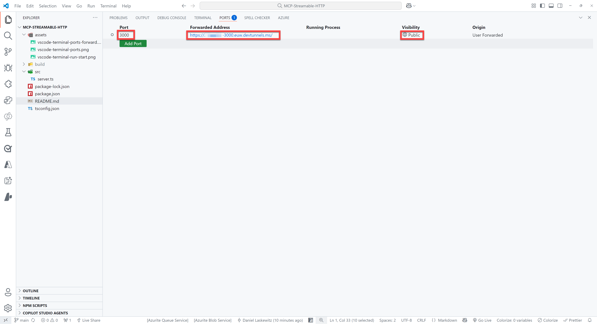

1. Open to the browser of your choice and paste the URL in the address bar, type `/mcp` behind it and hit enter

If all went well, you will see the following error message:

```json
{"jsonrpc":"2.0","error":{"code":-32000,"message":"Method not allowed."},"id":null}
```

Don't worry - this error message is nothing to be worried about!

### 🌎 Deploy to Azure {#deploy-to-azure}

> [!IMPORTANT]
> As listed in the [prerequisites](#prerequisites), the [Azure Developer CLI](https://learn.microsoft.com/azure/developer/azure-developer-cli/install-azd) needs to be installed on your machine for this part.

Make sure to login to Azure Developer CLI if you haven't done that yet.

```bash
azd auth login
```

> [!WARNING]  
> After running `azd up`, you will have an MCP Server running on Azure that is publicly available. Ideally, you don't want that. Make sure to run `azd down` after finishing the lab to delete all the resources from your Azure subscription. Learn how to run `azd down` by going to [this section](#lab-14-remove-the-azure-resources).

Run the following command in the terminal:

```bash
azd up
```

For the unique environment name, enter `mcsmcplab` or something similar. Select the Azure Subscription to use and select a value for the location. After that, it will take a couple of minutes before the server has been deployed. When it's done - you should be able to go to the URL that's listed at the end and add `/mcp` to the end of that URL.

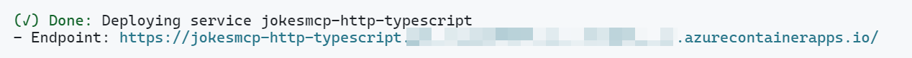

You should again see the following error:

```json
{"jsonrpc":"2.0","error":{"code":-32000,"message":"Method not allowed."},"id":null}
```

## 🧪 Lab 1.2 - Use the Jokes MCP Server in Visual Studio Code {#lab-12-use-the-jokes-mcp-server-in-visual-studio-code}

To use the Jokes MCP Server, you need to use the URL of your server (can be either your devtunnel URL or your deployed Azure Container App) with the `/mcp` part at the end and add it as an MCP Server in Visual Studio Code.

1. Press either `ctrl` + `shift` + `P` (Windows/Linux) or `cmd` + `shift` + `P` (Mac) and type `MCP`

1. Select **MCP: Add Server...**

1. Select **HTTP (HTTP or Server-Sent Events)**

1. Paste the URL of your server in the input box (make sure `/mcp` in the end is included)

1. Press `Enter`

1. Enter a name for the server, for instance `JokesMCP`

1. Select **User Settings** to save the MCP Server settings in your user settings

    This will add an MCP Server to your `settings.json` file. It should look like this:
    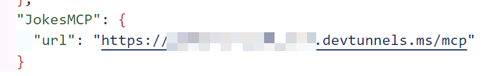

1. Open **GitHub Copilot**

1. Make sure you are in **Agent** mode

1. Make sure the **JokesMCP** server actions are selected when you select the tools icon:

    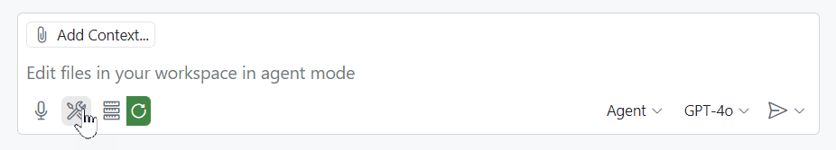

1. Ask the following question:

    ```text
    Get a chuck norris joke from the Dev category
    ```

This should give you a response like this:

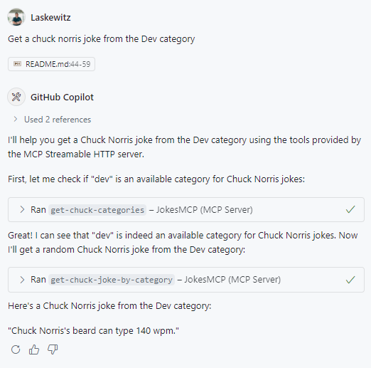

Now you have added the `JokesMCP` server to Visual Studio Code!

## 🧪 Lab 1.3 - Use the Jokes MCP Server in Microsoft Copilot Studio {#lab-13-use-the-jokes-mcp-server-in-microsoft-copilot-studio}

To use the Jokes MCP Server in Microsoft Copilot Studio, you need to create an agent and then add it as an MCP server.

### Create an agent and add the MCP server as a tool

1. Go to [Copilot Studio](https://copilotstudio.microsoft.com/)

1. Select the environment picker at the bottom left corner and select the environment you want to use

1. Select **Agents** in the left navigation

1. Select the either the **New Agent** or the **Create your first agent** button (both do the same thing)

    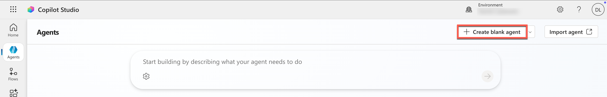

    > [!NOTE]
    > This will start creating your agent, usually within 10 seconds your agent will be visible.

1. Now you'll be able to change the name to **Jokester**

    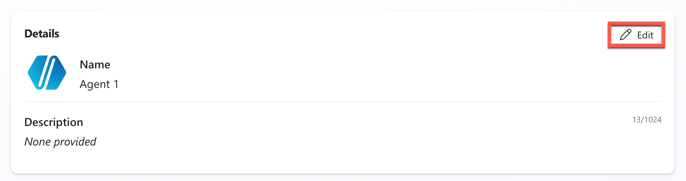

1. Change the name to:

    ```text
    Jokester
    ```

1. Add the following **Instructions**

    ```text
    You are a joke-telling assistant. Your sole purpose is to deliver appropriate, clever, and engaging jokes upon request. Follow these rules:
    
    * Respond only when the user asks for a joke or something related (e.g., "Tell me something funny").
    * Match the tone and humor preference of the user based on their input—clean, dark, dry, pun-based, dad jokes, etc.
    * Never break character or provide information unrelated to humor.
    * Keep jokes concise and clearly formatted.
    * Avoid offensive, discriminatory, or NSFW content.
    * When unsure about humor preference, default to a clever and universally appropriate joke.
    * Do not repeat jokes within the same session.
    * Avoid explaining the joke unless explicitly asked.
    * Be responsive, witty, and quick.
    ```

1. Select **Save** to save the instructions

1. Select **Tools** in the menu on the right

    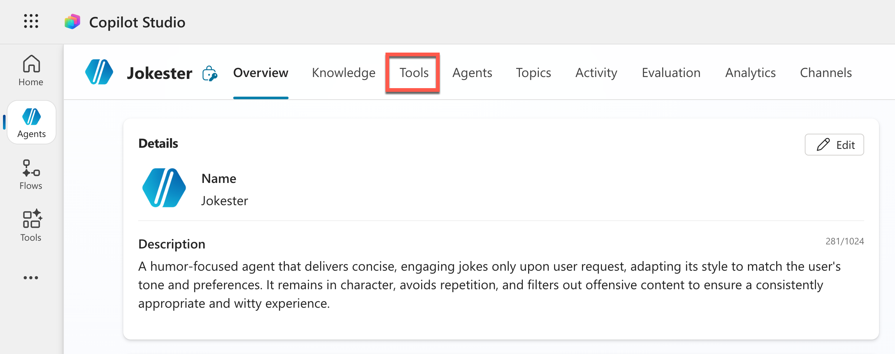

1. Select **Add** and then **Model Context Protocol MCP**

    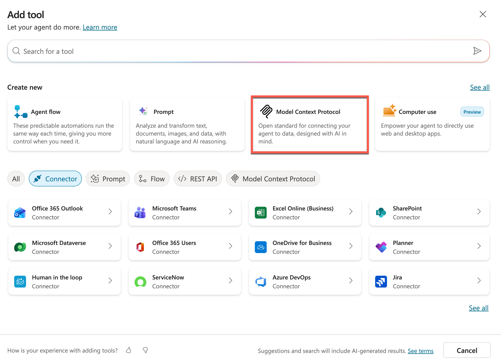

    This will open a wizard where you can create a new MCP server. You will need to provide the following information:

1. Enter the name:

    ```text
    Jokes MCP Server
    ```

1. Enter the description:

    ```text
    MCP server that fetches Chuck Norris and dad jokes on demand.
    ```

1. Enter the URL of the devtunnel. This should be something like `https://something-3000.something.devtunnels.ms/mcp` or the URL of your deployed MCP server in Azure

1. Select **Add** to create the MCP Server

    

    This will take a couple of seconds, because Copilot Studio is now creating a connector behind the scenes.

1. Select **Not connected** (1) and **Create new Connection** (2)

    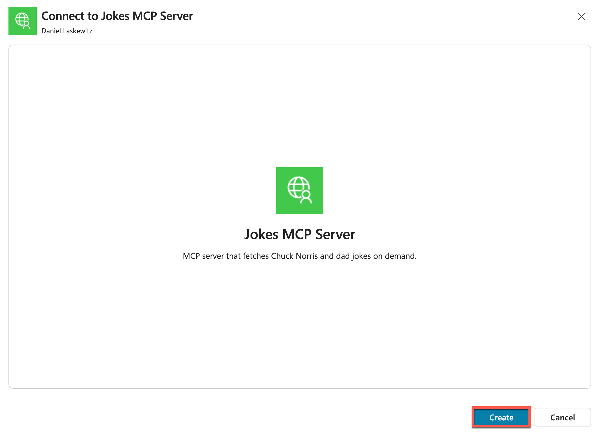

1. Enter a **display name** (1) if you want and select **Create** (2)

    

1. Select **Add** to add the MCP Server to the agent

    

    > [!TIP]
    > This will add your MCP server to the agent.
    >
    > 

1. Switch from *Build mode* to *Preview mode* by selecting **Preview** in the top middle.

    

1. In the Preview mode send the following message:

    ```text
    Can I get a Chuck Norris joke?
    ```
  
    This will show you a message that permission for the agent is required.

1. Select **Allow**

    
  
    This will allow the agent to use the MCP server and display a joke.

    

1. Now try the following message:

    ```text
    Can I get a Dad joke?
    ```

    This will now show a Dad joke.

    

And that was the Jokes MCP Server working in Microsoft Copilot Studio.

## 🧪 Lab 1.4 - Remove the Azure Resources {#lab-14-remove-the-azure-resources}

If you have deployed the MCP server to Azure, don't forget to remove the Azure resources. To remove the Azure resources after finishing the lab, run the following command in the terminal:

```bash
azd down
```

This command will show you the resources that will be deleted and then ask you to confirm. Confirm with `y` and the resources will be deleted. This can take a couple of minutes, but at the end you will see a confirmation:

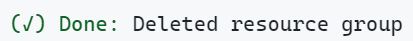

## ✅ Mission Accomplished {#mission-accomplished}

Congrats, agent — mission complete! You've built and deployed an MCP server and connected it to both GitHub Copilot and Microsoft Copilot Studio.

In this mission, you accomplished:

✅ **MCP Server Deployment**: Built and deployed a custom MCP server using Node.js and Docker

✅ **Local & Cloud Hosting**: Ran the server locally with port forwarding and deployed to Azure using Azure Developer CLI

✅ **GitHub Copilot Integration**: Connected the MCP server to Visual Studio Code and used it with GitHub Copilot Agent Mode

✅ **Copilot Studio Integration**: Wired the MCP server into a Copilot Studio agent with custom instructions and tool orchestration

## 🏅 Claim your completion badge {#claim-your-completion-badge}
<!-- markdownlint-disable-next-line MD033 -->
<p align="center"></p>

Congrats, agent — mission accomplished! Now it's time to claim your badge.

Simply submit the badge request form and answer all required questions:

[https://aka.ms/agent-academy-special-ops/mcsmcp/form](https://aka.ms/agent-academy-special-ops/mcsmcp/form)

Once your submission is reviewed, you will receive an email from Global AI Community with instructions to claim your badge.

> [!TIP]
> If you do not see the email, check your spam or junk folder.

## 📚 Tactical Resources {#tactical-resources}

📖 [Microsoft Copilot Studio MCP announcement blog](https://aka.ms/mcsmcp)
  
📖 [Microsoft Copilot Studio MCP docs](http://aka.ms/mcsmcpdocs)
  
📖 [Model Context Protocol overview](https://modelcontextprotocol.io/introduction)

<analytics-tag section="special-ops" mission="mcs-mcp" />
