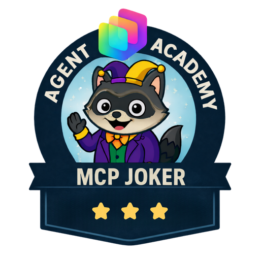

---
tags:
  - mcp
difficulty: 2
time: 30
harness: github-copilot
description: >-
  Connect a hosted MCP server to Microsoft Copilot Studio, use its tools,
  and explore interactive MCP Apps with the Zava Insurance sample.
badge: ./assets/MCP_Joker_Badge.png
products: [copilot-studio]
industries:
  - financial-services
created-date: 2026-02-20
last-edited-date: 2026-11-26
---
# 🤖 Microsoft Copilot Studio ❤️ MCP {#microsoft-copilot-studio-mcp}

<mission-meta />

<!-- markdownlint-disable-next-line MD033 -->
<p align="center"></p>

> [!WARNING] Draft mission scaffold
> This revision is being authored. Concepts and task outlines are drafted; detailed steps, connection settings, and screenshots still need validation in Copilot Studio. The displayed duration is provisional. Do not treat this scaffold as a completed walkthrough.

Welcome, agent. Your mission, should you choose to accept it, is to connect **Microsoft Copilot Studio** to the **Zava Insurance MCP server**. First, use MCP tools to retrieve claim information. Then explore **MCP Apps (preview)** to work with interactive views inside the conversation.

You'll use a hosted sample server, so you can focus on the agent experience without deploying infrastructure. The same server supplies ordinary data tools and tools that display an app.

> [!IMPORTANT] This mission uses the GitHub Copilot harness
> The Copilot Studio steps require an agent powered by the **GitHub Copilot harness**. Turn on **New Experience** before you create the agent.

## 🎯 Mission objectives {#mission-objectives}

In this mission, you'll learn:

1. How MCP exposes tools for a Copilot Studio agent to discover and call.
1. How to connect a hosted MCP server and request a text-based claim summary.
1. How MCP Apps extend tool results with an interactive interface.
1. How to distinguish a working tool call from a successfully rendered app.

## ⚙️ Prerequisites {#prerequisites}

- A [Microsoft Copilot Studio](https://copilotstudio.microsoft.com/) account and environment where you can create agents powered by the **GitHub Copilot harness**.
- Permission to add an external MCP server and create its required connection, subject to your organization's policies.
- Access to **MCP Apps (preview)** in Copilot Studio preview chat.
- Access to the hosted sample endpoint: `https://zava-insurance-mcp.azurewebsites.net/mcp`.

You don't need a local copy of the server or your own Azure subscription for this hosted walkthrough.

> [!WARNING] Shared demo data
> Use only synthetic sample data. Don't enter customer information, credentials, or confidential content. The sample includes write tools, but this mission uses read-only exercises. Don't approve claims, create inspections, or change records on the shared server.

<!-- TODO: Validate hosted endpoint availability, authentication requirements, preview access, and applicable environment policies before completing the connection steps. -->

> [!IMPORTANT] GitHub Copilot harness billing
> This mission uses the **GitHub Copilot harness in Microsoft Copilot Studio**, which uses usage-based billing. Building, testing in Preview, evaluating, and using the agent might consume **Copilot Credits**. Review the [Copilot Credits billing overview](https://learn.microsoft.com/microsoft-copilot-studio/agents-experience/billing-credit-overview) before you begin.

## ❓ What is MCP? {#what-is-mcp}

[Model Context Protocol (MCP)](https://modelcontextprotocol.io/introduction) standardizes how an AI application connects to tools and context. An MCP server describes its available tools, including their purpose and inputs. The agent can use those descriptions to choose a tool when responding to a request.

Think of the server as an insurance service desk with a published menu. The agent reads the menu, selects the service, and supplies the required details. A claim-summary tool returns information; the agent uses that result to answer you.

Connecting a server doesn't authorize every operation it offers. Connections, authentication, permissions, and your organization's policies still apply. In this mission, stay with read-only claim and contractor information.

### MCP and connectors {#mcp-vs-connectors}

MCP and connectors aren't competing choices. Copilot Studio uses connector infrastructure for MCP integrations, bringing connections and organizational governance into the setup. Follow the [MCP server connection guidance](https://learn.microsoft.com/microsoft-copilot-studio/agents-experience/tools-add-mcp-server) for the current experience.

## 🎯 The Zava Insurance scenario {#the-zava-insurance-scenario}

Zava Insurance needs an agent that helps claims staff inspect sample claims without switching between several screens. You'll begin with a text summary, then add a visual way to explore claims and contractors in the same conversation.

The [Zava Insurance Node sample](https://github.com/microsoft/mcp-interactiveUI-samples/tree/main/mcp-apps/zava-insurance/node) provides both tool types:

| Tool | Purpose | Experience |
| --- | --- | --- |
| `get-claim-summary` | Retrieve key details for a claim | Text result for the agent to summarize |
| `show-claims-dashboard` | Display claims, filters, and summary metrics | Interactive dashboard |
| `show-claim-detail` | Display a claim and its related information | Interactive detail view |
| `show-contractors` | Display contractors with optional filters | Interactive contractor list |

These names come from the sample source. Confirm the hosted server's discovered catalog before finalizing the walkthrough; a deployed version might differ.

## 🧪 Lab 1: Connect the server and use MCP tools {#lab-1-connect-and-use-tools}

Start with a data tool. Establish that the connection and tool invocation work before introducing interactive rendering.

### Lab 1.1: Create the Zava agent {#lab-11-create-the-zava-agent}

1. Open [Copilot Studio](https://copilotstudio.microsoft.com/).
1. Select the environment for this mission.
1. Turn on **New Experience**.
1. Create an agent named `Zava Insurance Assistant`.
1. Add the following draft instructions:

    ```text
    Help users explore Zava Insurance sample claims and contractors.
    Use the connected MCP server for claim and contractor information.
    For a text-only summary, use get-claim-summary.
    When the user requests a dashboard, claim detail view, or contractor
    list, use the matching show-claims-dashboard, show-claim-detail,
    or show-contractors tool.
    Use only read-only tools. Do not update claims, inspections, or
    purchase orders, and do not create records.
    If information is unavailable, explain the issue instead of inventing it.
    ```

    > [!NOTE]
    > Instructions guide tool selection; they aren't an authorization boundary. Where supported, expose only the read-only tools needed for the exercises.

1. Save the agent.

[FILL IN: Validate the current agent-creation controls and instruction-saving steps in the GitHub Copilot harness.]

<!-- TODO: Add screenshot of the Zava agent and saved instructions. -->

### Lab 1.2: Connect the hosted MCP server {#lab-12-connect-the-hosted-mcp-server}

1. Open the agent's tool configuration.
1. Add an MCP server using the following details:

    | Setting | Value |
    | --- | --- |
    | Name | `Zava Insurance MCP` |
    | Description | `Read sample insurance claims and explore interactive claims and contractor views.` |
    | Server URL | `https://zava-insurance-mcp.azurewebsites.net/mcp` |

1. Configure the required authentication and connection.

    [FILL IN: Confirm the hosted endpoint's authentication requirements and document the exact connection and consent steps. Do not assume anonymous access.]

1. Inspect the discovered tools.
1. Confirm that `get-claim-summary` is available.

[FILL IN: Document the validated tool-addition UI, read-only tool selection where available, and how to inspect discovered tool descriptions and inputs.]

<!-- TODO: Add screenshots of the server URL, connection setup, and discovered tools. -->

**Checkpoint:** The server is connected and the agent can discover the expected data tool. Seeing a tool in the catalog isn't proof that its execution succeeds.

### Lab 1.3: Request a text-only claim summary {#lab-13-request-a-text-only-claim-summary}

1. Open the agent in **Preview**.
1. Send this sample prompt:

    ```text
    Use get-claim-summary to give me a text-only summary of claim 1.
    Do not open a dashboard or interactive view.
    ```

1. Complete any required connection consent.
1. Inspect the execution details to identify the tool called and its result.

[FILL IN: Confirm a valid synthetic claim ID on the hosted server and replace the example if needed. Document the execution-details UI and expected result without depending on changing claim values.]

<!-- TODO: Add screenshot of the text response and get-claim-summary invocation. -->

**Checkpoint:** The agent calls `get-claim-summary` and answers from returned data without opening an app. If the tool fails, resolve the connection or input issue before continuing.

## 🖥️ What are MCP Apps? {#what-are-mcp-apps}

An ordinary MCP tool gives the agent a result to reason about. **MCP Apps** let a tool also provide an interactive interface that a supported host renders inside the conversation.

> [!IMPORTANT] Preview support
> MCP Apps are in preview. The [supported experiences and capabilities](https://learn.microsoft.com/microsoft-copilot-studio/agents-experience/mcp-apps) can change. This lab targets **Copilot Studio preview chat**, not Teams or web chat.

Return to the service-desk analogy: a tool gives you an answer across the counter; an app adds a shared workspace where you can inspect and filter the information yourself. The app doesn't replace the tool or its connection.

The server associates a tool with a UI resource through `_meta.ui.resourceUri`. After the tool runs, the host retrieves that resource and renders its HTML using the MCP Apps MIME type, `text/html;profile=mcp-app`. The app can call tools and read resources through the configured MCP integration.

| Ordinary tool result | Tool with an MCP App |
| --- | --- |
| The agent receives data and can summarize it. | The host can also render the declared UI resource. |
| The conversation provides the primary interaction. | The user can also interact with the app's controls. |
| Success requires a working tool invocation. | Success also requires a valid resource and supported host rendering. |

Adding an MCP server doesn't automatically turn every tool into an app. The server must supply a UI resource, and the host must support the capabilities that app uses.

> [!INFO] Security and host support
> The host renders app content in a sandboxed iframe with content security policy restrictions. Apps don't receive direct access to host credentials. Connection and runtime checks still apply to tool calls. See the [supported capabilities and security guidance](https://learn.microsoft.com/microsoft-copilot-studio/agents-experience/mcp-apps).

## 🧪 Lab 2: Explore MCP Apps (preview) {#lab-2-explore-mcp-apps}

Use the same server and agent to move from a text response to an interactive experience. Run these exercises in Copilot Studio preview chat.

### Lab 2.1: Open the claims dashboard {#lab-21-open-the-claims-dashboard}

1. Confirm that `show-claims-dashboard` is available to the agent.
1. Send this sample prompt:

    ```text
    Show the Zava Insurance claims dashboard.
    ```

1. Inspect the tool execution and the rendered result.
1. Explore a read-only dashboard filter.

[FILL IN: Validate dashboard rendering in Copilot Studio preview chat. Document the available filter controls and their observable effect.]

<!-- TODO: Add screenshot of the rendered dashboard and a filtered view. -->

**Checkpoint:** The dashboard appears as an interactive app, not just a text description or link. A filter changes the displayed claims without changing claim records.

### Lab 2.2: Inspect a claim {#lab-22-inspect-a-claim}

1. Identify a synthetic claim ID from the dashboard.
1. Request its detail view, replacing the example ID if needed:

    ```text
    Show the interactive claim detail view for claim 1.
    ```

1. Inspect the `show-claim-detail` result.
1. Compare the detail view with the text-only summary from Lab 1.

[FILL IN: Document the validated detail-view fields and any supported read-only navigation from the dashboard. Don't assume every interaction from the sample's Microsoft 365 demo works in Copilot Studio.]

<!-- TODO: Add screenshot of the claim detail app in Copilot Studio. -->

**Checkpoint:** The app displays details for the requested claim. Explain what you can inspect directly in the app versus asking the agent in text.

### Lab 2.3: Explore contractors {#lab-23-explore-contractors}

1. Confirm that `show-contractors` is available to the agent.
1. Send this sample prompt:

    ```text
    Show me the preferred roofing contractors.
    ```

1. Inspect the contractor list and tool inputs.
1. Explore the available read-only filters.

[FILL IN: Confirm matching sample data, supported filters, and how to distinguish prompt-supplied filtering from interaction inside the app.]

<!-- TODO: Add screenshot of the contractor list and its filters. -->

**Checkpoint:** The contractor app appears and reflects the requested criteria, or clearly shows that no matching data is available. Don't assign contractors or modify records.

## 🛠️ Troubleshooting checkpoints {#troubleshooting-checkpoints}

| Symptom | Check |
| --- | --- |
| Server connection or tool discovery fails | Endpoint availability, connection settings, authentication, and environment policy. |
| A tool runs but no app appears | Use a UI-enabled `show-*` tool in a supported host. Check the declared UI resource and resource-read result. |
| App content or external resources are blocked | Check the UI resource's content security policy and declared external domains. |
| A claim isn't found or a filter returns no matches | Confirm the current synthetic data rather than assuming fixed records. |
| The agent selects the wrong tool | Inspect tool descriptions, instructions, and execution details. |

[FILL IN: Add validated Copilot Studio error messages and recovery steps. Keep connection, tool-execution, and UI-rendering failures distinct.]

## ✅ Mission Accomplished {#mission-accomplished}

Once you've completed the validated walkthrough, you can demonstrate:

✅ **MCP tools**: Connect a hosted server and retrieve claim information through a data tool.

✅ **MCP Apps**: Open interactive claims and contractor views from UI-enabled tools.

✅ **Troubleshooting**: Distinguish tool execution, UI resource retrieval, and app rendering.

<!-- TODO: Validate the complete learner journey and review badge completion questions against the updated objectives before publishing this revision. -->

## 🏅 Claim your completion badge {#claim-your-completion-badge}

<!-- markdownlint-disable-next-line MD033 -->
<p align="center"></p>

After completing the mission, submit the badge request form and answer all required questions:

[https://aka.ms/agent-academy-special-ops/mcsmcp/form](https://aka.ms/agent-academy-special-ops/mcsmcp/form)

Once your submission is reviewed, you will receive an email from Global AI Community with instructions to claim your badge.

> [!TIP]
> If you do not see the email, check your spam or junk folder.

## 📚 Tactical Resources {#tactical-resources}

- [Zava Insurance MCP Apps sample (Node)](https://github.com/microsoft/mcp-interactiveUI-samples/tree/main/mcp-apps/zava-insurance/node)
- [Explore the MCP Apps sample collection](https://github.com/microsoft/mcp-interactiveUI-samples/tree/main/mcp-apps)
- [Use MCP Apps in Copilot Studio](https://learn.microsoft.com/microsoft-copilot-studio/agents-experience/mcp-apps)
- [Add an MCP server to your agent as a tool](https://learn.microsoft.com/microsoft-copilot-studio/agents-experience/tools-add-mcp-server)
- [Model Context Protocol overview](https://modelcontextprotocol.io/introduction)
- [Operative Mission 10: Integrate with MCP Servers](../../operative/10-mcp/index.md)
- [Microsoft Learn MCP Server](../ms-learn-mcp/index.md)
- [Secure an MCP Server with OAuth 2.0](../mcp-oauth/index.md)

> [!NOTE] Sample implementation versus this lab
> The Zava sample README describes a Microsoft 365 declarative agent and its development setup. This mission reuses the hosted MCP server in Copilot Studio; it doesn't require Agents Toolkit provisioning.

<analytics-tag section="special-ops" mission="mcs-mcp" />
